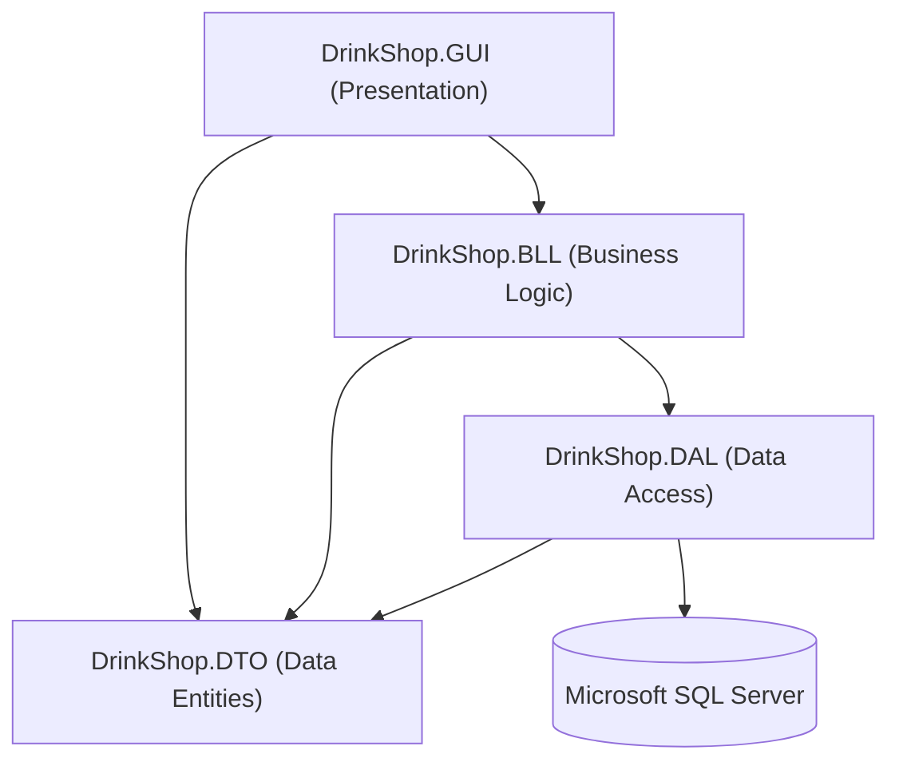
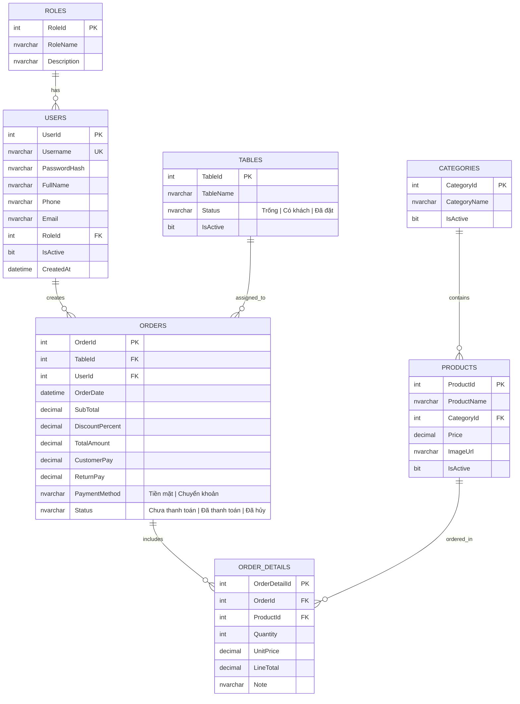
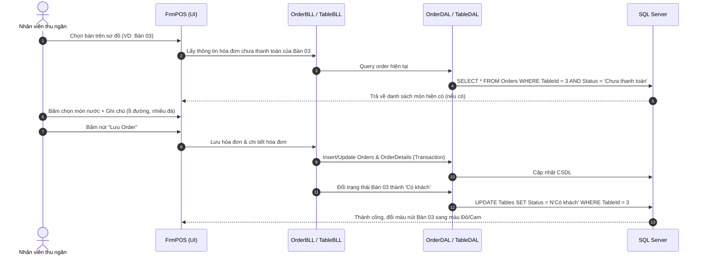

# DRINK SHOP MANAGEMENT SYSTEM
> **Hệ thống Quản lý Quán nước / Trà sữa / Cafe**  
> Dự án môn học: **Lập trình .NET** - Khoa Công nghệ Thông tin, Trường Đại học Điện Lực (EPU)

---

### 📋 THÔNG TIN DỰ ÁN & KIẾN TRÚC TỔNG QUAN
*(Drink Shop Management System, 3-Tier Architecture, Modern Flat UI, ADO.NET Direct SQL Connection & Real-time POS Billing)*

- **Học phần**: Lập trình .NET
- **Khoa / Trường**: Khoa Công nghệ Thông tin - Trường Đại học Điện Lực (EPU)
- **Chủ đề lựa chọn**: Hệ thống Quản lý Quán nước / Trà sữa / Cafe (Mô hình chuỗi F&B - Bán hàng tại bàn & Mang về, Quản lý sơ đồ bàn trực quan, Danh mục thực đơn đồ uống, Hóa đơn thanh toán & Báo cáo doanh thu thời gian thực)
- **Người soạn thảo**: Nguyễn Thành Đạt (Trưởng nhóm / System Architect / Lead Developer)
- **Người duyệt / Đồng chủ trì đề tài**: Nguyễn Trọng Hiếu & Lê Tuấn Anh
- **Kiến trúc cốt lõi**: Mô hình 3 lớp phân tầng chuẩn (*Presentation Layer* - GUI WinForms, *Business Logic Layer* - BLL, *Data Access Layer* - DAL, *Data Transfer Objects* - DTO), Kết nối trực tiếp Microsoft SQL Server bằng ADO.NET thuần (`SqlConnection`, `SqlCommand`, `SqlDataReader`, Parameterized Queries phòng chống SQL Injection tuyệt đối), Giao diện phẳng Modern Flat UI tối ưu trải nghiệm người dùng, Sơ đồ bàn trực quan đổi màu theo trạng thái thực tế (*Trống / Có khách / Đã đặt*), Phân quyền bảo mật 2 cấp độ (*Quản trị viên / Nhân viên thu ngân*), Báo cáo thống kê doanh thu & Biểu đồ Chart trực quan.
- **Tài liệu thiết kế chi tiết**: `README.md` (Phiên bản 2.0 - Hệ thống Quản lý Quán nước EPU)

> ⚠️ **LƯU Ý QUAN TRỌNG CHO CẢ NHÓM:**  
> Trước khi bắt đầu viết code, cả 3 thành viên cần thống nhất tuyệt đối phiên bản .NET mục tiêu (.NET 8.0 Windows Desktop), phiên bản SQL Server, tên namespace `DrinkShop` và cấu trúc Solution 3 lớp. Không tự ý thay đổi các quy ước này khi chưa họp và trao đổi thống nhất trong nhóm.

---

### ☕ BỐI CẢNH & GIỚI THIỆU ĐỀ TÀI (INTRODUCTION)
Trong bối cảnh thị trường dịch vụ F&B (Food and Beverage) — đặc biệt là ngành kinh doanh đồ uống, trà sữa và cà phê — đang phát triển mạnh mẽ và cạnh tranh ngày càng gay gắt, việc tối ưu hóa quy trình phục vụ và nâng cao độ chính xác trong vận hành đóng vai trò quyết định đến hiệu quả kinh doanh của mỗi cửa hàng.

Các phương thức quản lý truyền thống (ghi chép sổ sách thủ công, ghi nhớ miệng hoặc sử dụng các bảng tính rời rạc) thường bộc lộ nhiều hạn chế nghiêm trọng:
- ❌ **Dễ nhầm lẫn order**: Sai lệch định lượng đường/đá, ghi nhầm hoặc sót món của khách trong các khung giờ cao điểm.
- ❌ **Khó theo dõi trạng thái bàn**: Không nắm bắt trực quan bàn nào còn trống, bàn nào đang có khách hoặc đã đặt trước, gây bất tiện khi xếp chỗ và đổi/gộp bàn.
- ❌ **Rủi ro thất thoát doanh thu**: Tính toán sai tiền thừa, nhầm lẫn chiết khấu hoặc thiếu công cụ đối soát hóa đơn minh bạch giữa ca làm việc của nhân viên.
- ❌ **Thiếu báo cáo kinh doanh thời gian thực**: Người quản lý không có cái nhìn tổng quan về doanh thu theo ngày/tháng, không xác định được nhóm đồ uống nào đang bán chạy (Best-sellers) để lập kế hoạch nhập nguyên liệu.

Xuất phát từ thực tiễn trên, **Drink Shop Management System** được nhóm nghiên cứu và xây dựng như một **giải pháp phần mềm quản trị bán hàng toàn diện dành cho các quán đồ uống**. Ứng dụng được phát triển trên nền tảng **C# Windows Forms** với phong cách giao diện phẳng hiện đại (**Modern Flat UI**), kết nối trực tiếp cơ sở dữ liệu **Microsoft SQL Server** qua công nghệ **ADO.NET thuần**. Hệ thống giải quyết trọn vẹn chu trình bán hàng: từ tiếp nhận order, sơ đồ bàn trực quan đổi màu trạng thái, tính toán tự động & in hóa đơn tức thời, đến quản trị danh mục sản phẩm, phân quyền nhân viên và trực quan hóa doanh thu bằng biểu đồ.

---

## 📑 MỤC LỤC (TABLE OF CONTENTS)
- [1. 👥 THÀNH VIÊN THỰC HIỆN & MA TRẬN TRÁCH NHIỆM (RACI MATRIX)](#1--thành-viên-thực-hiện--ma-trận-trách-nhiệm-raci-matrix)
- [2. 📌 MỤC TIÊU DỰ ÁN & PHẠM VI NGHIỆP VỤ](#2--mục-tiêu-dự-án--phạm-vi-nghiệp-vụ)
- [3. 🛠️ CÔNG NGHỆ SỬ DỤNG](#3-️-công-nghệ-sử-dụng)
- [4. 🍵 DANH MỤC THỰC ĐƠN ĐỒ UỐNG KHỞI TẠO (INITIAL MENU DEMO)](#4--danh-mục-thực-đơn-đồ-uống-khởi-tạo-initial-menu-demo)
- [5. 🏗️ CẤU TRÚC SOLUTION & Ý NGHĨA CÁC TẦNG (3-TIER ARCHITECTURE)](#5-️-cấu-trúc-solution--ý-nghĩa-các-tầng-3-tier-architecture)
- [6. 🗄️ CƠ SỞ DỮ LIỆU DÙNG CHUNG & THIẾT KẾ SCHEMA (ERD)](#6-️-cơ-sở-dữ-liệu-dùng-chung--thiết-kế-schema-erd)
- [7. 🔄 QUY TRÌNH NGHIỆP VỤ CỐT LÕI (POS & TABLE ORDER FLOW)](#7--quy-trình-nghiệp-vụ-cốt-lõi-pos--table-order-flow)
- [8. 📅 KẾ HOẠCH TRIỂN KHAI THEO GIAI ĐOẠN (ROADMAP)](#8--kế-hoạch-triển-khai-theo-giai-đoạn-roadmap)
- [9. 🐙 QUY ƯỚC GIT & GITHUB WORKFLOW CHO NHÓM](#9--quy-ước-git--github-workflow-cho-nhóm)
- [10. 🖼️ QUY TRÌNH TÍCH HỢP FORM LÊN MASTER UI](#10-️-quy-trình-tích-hợp-form-lên-master-ui)
- [11. 🎨 QUY CHUẨN ĐẶT TÊN CONTROL & CODE CONVENTIONS](#11--quy-chuẩn-đặt-tên-control--code-conventions)
- [12. 📋 CHECKLIST KIỂM THỬ TRƯỚC KHI BÀN GIAO](#12--checklist-kiểm-thử-trước-khi-bàn-giao)
- [13. 🚀 HƯỚNG DẪN CÀI ĐẶT VÀ CHẠY DỰ ÁN (SETUP & RUN GUIDE)](#13--hướng-dẫn-cài-đặt-và-chạy-dự-án-setup--run-guide)
- [14. 🤝 NGUYÊN TẮC PHỐI HỢP LÀM VIỆC NHÓM](#14--nguyên-tắc-phối-hợp-làm-việc-nhóm)
- [15. 📑 KHUNG ĐỀ CƯƠNG BÁO CÁO ĐỒ ÁN (PROJECT REPORT OUTLINE - CHUẨN EPU)](#15--khung-đề-cương-báo-cáo-đồ-án-project-report-outline---chuẩn-epu)

---

## 1. 👥 THÀNH VIÊN THỰC HIỆN & MA TRẬN TRÁCH NHIỆM (RACI MATRIX)

### 1.1. Danh sách thành viên
1. **Nguyễn Thành Đạt** (Trưởng nhóm / System Architect / Lead Developer)
   - Phụ trách kiến trúc hệ thống 3 lớp, thiết kế Database schema chính, xây dựng core DAL (`DatabaseHelper.cs`), điều phối Git repository, tích hợp và kiểm thử tổng thể.
2. **Nguyễn Trọng Hiếu** (Core Developer / UI-UX & POS Specialist)
   - Phụ trách thiết kế giao diện chính (`FrmMain`, Sidebar), phân hệ Bán hàng POS (`FrmPOS`), phân hệ Quản lý sơ đồ bàn (`FrmTable`), phân hệ Hóa đơn & In ấn (`FrmInvoice`).
3. **Lê Tuấn Anh** (Core Developer / Business Logic & Reporting Specialist)
   - Phụ trách phân hệ Quản lý Danh mục & Sản phẩm đồ uống (`FrmCategory`, `FrmProduct`), Quản lý tài khoản nhân viên & phân quyền (`FrmEmployee`), Dashboard tổng quan & Báo cáo doanh thu biểu đồ (`FrmStatistic`, `FrmDashboard`).

### 1.2. Ma trận Trách nhiệm (RACI Matrix)

> **Quy ước chuẩn quốc tế:**
> - **R (Responsible)**: Người trực tiếp thực hiện công việc.
> - **A (Accountable)**: Người chịu trách nhiệm chính, kiểm tra và nghiệm thu sản phẩm.
> - **C (Consulted)**: Người hỗ trợ, cố vấn chuyên môn, phối hợp thực hiện.
> - **I (Informed)**: Người được thông báo tiến độ, kết quả công việc.

| STT | Giai đoạn / Module chức năng | Nguyễn Thành Đạt | Nguyễn Trọng Hiếu | Lê Tuấn Anh |
| :---: | :--- | :---: | :---: | :---: |
| **1** | **Khởi tạo kiến trúc 3 lớp & Database (`DrinkShopDB`)** | **A / R** | C | C |
| **2** | **Xây dựng Data Access Layer (`DatabaseHelper.cs`) & DTOs** | **A / R** | I | I |
| **3** | **Thiết kế UI Khung Master (`FrmMain`, Sidebar điều hướng)** | A | **R** | C |
| **4** | **Phân hệ Đăng nhập, Xác thực & Phân quyền (`FrmLogin`)** | **A / R** | C | I |
| **5** | **Phân hệ Quản lý Danh mục & Sản phẩm (`FrmCategory`, `FrmProduct`)** | A | C | **R** |
| **6** | **Phân hệ Sơ đồ Bàn & Bán hàng POS (`FrmTable`, `FrmPOS`)** | A | **R** | C |
| **7** | **Phân hệ Quản lý Hóa đơn & In ấn (`FrmInvoice`, `PrintPreview`)** | A | **R** | C |
| **8** | **Phân hệ Quản lý Nhân viên & Tài khoản (`FrmEmployee`)** | A | C | **R** |
| **9** | **Phân hệ Báo cáo Doanh thu & Dashboard Chart (`FrmStatistic`, `FrmDashboard`)** | A | C | **R** |
| **10**| **Xử lý ngoại lệ toàn cục, Tối ưu hóa & Kiểm thử tích hợp** | **A / R** | R | R |
| **11**| **Đóng gói phần mềm & Hoàn thiện báo cáo đồ án** | **A** | R | R |

---

## 2. 📌 MỤC TIÊU DỰ ÁN & PHẠM VI NGHIỆP VỤ

### 2.1. Mục tiêu dự án
Xây dựng một ứng dụng Desktop hoàn chỉnh, chuyên nghiệp phục vụ quản lý quán nước/trà sữa/cafe với các tiêu chí:
- Thao tác bán hàng tại quầy nhanh nhạy, trực quan, hạn chế tối đa số lần click chuột.
- Kết nối dữ liệu thời gian thực trực tiếp với Microsoft SQL Server thông qua ADO.NET thuần, không sử dụng dữ liệu giả (fake/mock data).
- Quản lý chính xác sơ đồ bàn, tình trạng phục vụ và doanh thu từng ca làm việc.
- Phạm vi ban đầu được thiết kế vừa phải, chặt chẽ để cả nhóm 3 người hoàn thành đúng tiến độ, dễ tích hợp và kiểm thử.

### 2.2. Phạm vi nghiệp vụ hệ thống
1. **Quản lý hệ thống & Tài khoản**: Đăng nhập, đăng xuất, phân quyền 2 cấp độ (Quản trị viên / Nhân viên thu ngân), đổi mật khẩu.
2. **Quản lý danh mục & Đồ uống**: CRUD loại đồ uống, CRUD món nước (tên món, giá bán, hình ảnh đại diện, danh mục).
3. **Quản lý sơ đồ bàn**: Hiển thị trực quan trạng thái bàn (*Trống*, *Có khách*, *Đã đặt*), thêm/sửa/xóa bàn, đổi bàn và gộp bàn.
4. **Bán hàng POS (Point of Sale)**: Chọn bàn -> Chọn món -> Thêm ghi chú (đường/đá/topping) -> Tăng/giảm số lượng -> Áp dụng chiết khấu -> Tính tiền thừa -> Thanh toán & In phiếu hóa đơn.
5. **Quản lý hóa đơn**: Tra cứu lịch sử hóa đơn theo ngày/nhân viên, xem lại chi tiết món đã gọi, in lại phiếu tính tiền khi cần.
6. **Thống kê & Báo cáo**: Tổng quan KPI (Doanh thu hôm nay, Số hóa đơn, Số bàn đang có khách), thống kê doanh thu theo khoảng ngày, danh sách Top 5 đồ uống bán chạy nhất (Best-sellers) và vẽ biểu đồ trực quan.

---

## 3. 🛠️ CÔNG NGHỆ SỬ DỤNG

| Thành phần | Công nghệ / Công cụ lựa chọn | Phiên bản khuyến nghị | Ghi chú |
| :--- | :--- | :--- | :--- |
| **Ngôn ngữ lập trình** | C# | 10.0 / 12.0 | Ngôn ngữ chính hướng đối tượng |
| **Nền tảng ứng dụng** | .NET Windows Desktop | .NET 8.0 (LTS) | Hiện đại, hiệu năng cao, hỗ trợ lâu dài |
| **Giao diện người dùng** | Windows Forms (WinForms) | WinForms .NET 8 | Phong cách Modern Flat UI, Segoe UI |
| **Hệ quản trị CSDL** | Microsoft SQL Server | 2019 / 2022 / SQL Express | RDBMS chuẩn doanh nghiệp |
| **Công cụ quản trị CSDL**| SQL Server Management Studio (SSMS) | SSMS 19.x / 20.x | Soạn thảo & thực thi script SQL |
| **Công nghệ kết nối DB** | ADO.NET thuần (`Microsoft.Data.SqlClient`) | Bản mới nhất | Parameterized Queries chống SQL Injection |
| **Môi trường phát triển**| Visual Studio Community | 2022 (v17.8 trở lên) | Workload: *.NET desktop development* |
| **Quản lý mã nguồn** | Git & GitHub | Git 2.x | Quản lý nhánh theo mô hình GitFlow rút gọn |

---

## 4. 🍵 DANH MỤC THỰC ĐƠN ĐỒ UỐNG KHỞI TẠO (INITIAL MENU DEMO)

Dự án sử dụng **6 nhóm danh mục chuẩn thực tế** để dữ liệu demo gọn gàng, đẹp mắt và thuận tiện cho việc kiểm thử tích hợp:

| Mã loại | Tên danh mục | Các món nước tiêu biểu (Demo ban đầu) | Đơn giá mẫu |
| :---: | :--- | :--- | :---: |
| **DM01** | **Cà phê** | Cà phê đen đá, Cà phê sữa đá, Bạc xỉu Sài Gòn, Espresso | 20.000 - 35.000 đ |
| **DM02** | **Trà sữa** | Trà sữa truyền thống, Trà sữa Thái xanh, Trà sữa Ô long nướng | 30.000 - 45.000 đ |
| **DM03** | **Trà trái cây** | Trà đào cam sả, Trà vải lài sen, Trà dâu tằm nhiệt đới | 35.000 - 45.000 đ |
| **DM04** | **Đá xay (Freeze)** | Freeze trà xanh matcha, Cà phê đá xay kem tươi, Choco Freeze | 40.000 - 50.000 đ |
| **DM05** | **Nước ép & Sinh tố**| Nước ép cam tươi, Nước ép dưa hấu, Sinh tố bơ sáp | 30.000 - 45.000 đ |
| **DM06** | **Bánh & Topping** | Bánh Tiramisu, Cheesecake chanh leo, Trân châu hoàng kim, Pudding | 10.000 - 35.000 đ |

*Lưu ý: Có thể bổ sung thêm danh mục và đồ uống sau khi nhóm hoàn thành kiểm thử các chức năng CRUD.*

---

## 5. 🏗️ CẤU TRÚC SOLUTION & Ý NGHĨA CÁC TẦNG (3-TIER ARCHITECTURE)

### 5.1. Cấu trúc thư mục Solution chuẩn

```
DrinkShopManagement/
├── DrinkShopManagement.sln
│
├── DrinkShop.GUI/                     # Presentation Layer (WinForms UI)
│   ├── Forms/
│   │   ├── FrmLogin.cs                # Đăng nhập hệ thống
│   │   ├── FrmMain.cs                 # Form Master (Header, Sidebar, Content Panel)
│   │   ├── FrmDashboard.cs            # Thẻ KPI tổng quan
│   │   ├── FrmPOS.cs                  # Màn hình bán hàng gọi món tại bàn
│   │   ├── FrmTable.cs                # Quản lý sơ đồ bàn
│   │   ├── FrmProduct.cs              # Quản lý đồ uống & hình ảnh
│   │   ├── FrmCategory.cs             # Quản lý danh mục
│   │   ├── FrmInvoice.cs              # Tra cứu & in hóa đơn
│   │   ├── FrmEmployee.cs             # Quản lý nhân viên & tài khoản
│   │   └── FrmStatistic.cs            # Báo cáo doanh thu & biểu đồ
│   ├── Helpers/
│   │   ├── FormHelper.cs              # Mở form con nhúng vào Panel nội dung
│   │   └── UITheme.cs                 # Bảng màu sắc & phong cách giao diện
│   ├── UserControls/
│   │   ├── UcProductCard.cs           # Thẻ món nước hiển thị trong POS
│   │   └── UcTableButton.cs           # Nút bàn đổi màu trạng thái
│   ├── Program.cs
│   └── App.config                     # Chuỗi kết nối ConnectionString
│
├── DrinkShop.BLL/                     # Business Logic Layer (Xử lý nghiệp vụ & Validate)
│   ├── AuthBLL.cs
│   ├── UserBLL.cs
│   ├── CategoryBLL.cs
│   ├── ProductBLL.cs
│   ├── TableBLL.cs
│   ├── OrderBLL.cs
│   └── StatisticBLL.cs
│
├── DrinkShop.DAL/                     # Data Access Layer (ADO.NET Direct Connection)
│   ├── DatabaseHelper.cs              # Quản lý kết nối SQL, thực thi Reader/Scalar/Command
│   ├── UserDAL.cs
│   ├── CategoryDAL.cs
│   ├── ProductDAL.cs
│   ├── TableDAL.cs
│   ├── OrderDAL.cs
│   └── StatisticDAL.cs
│
├── DrinkShop.DTO/                     # Data Transfer Objects (Entity Models)
│   ├── RoleDTO.cs
│   ├── UserDTO.cs
│   ├── CategoryDTO.cs
│   ├── ProductDTO.cs
│   ├── TableDTO.cs
│   ├── OrderDTO.cs
│   ├── OrderDetailDTO.cs
│   └── StatisticDTO.cs
│
├── Database/                          # Kịch bản cơ sở dữ liệu dùng chung
│   ├── DrinkShopDB.sql                # Tạo Database, bảng, khóa chính, khóa ngoại, index
│   └── SampleData.sql                 # Dữ liệu ban đầu (Tài khoản mẫu, Menu, Bàn mẫu)
│
├── Documents/                         # Tài liệu đồ án
│   ├── ERD.png                        # Sơ đồ thực thể liên kết
│   ├── DeCuongBaoCao.docx             # Báo cáo đồ án chi tiết
│   └── PhanCongCongViec.docx          # Bảng phân công chi tiết
│
└── README.md
```

### 5.2. Ý nghĩa các tầng & Quan hệ tham chiếu (Project References)
- **GUI (Presentation Layer)**: Chịu trách nhiệm hiển thị giao diện, bắt sự kiện click/input của người dùng, gọi tầng BLL để lấy/xử lý dữ liệu và hiển thị lên controls.
- **BLL (Business Logic Layer)**: Kiểm tra tính hợp lệ của dữ liệu (Validate), áp dụng các quy tắc kinh doanh (tính tiền thừa, giảm giá, kiểm tra trùng lặp), làm cầu nối giữa GUI và DAL.
- **DAL (Data Access Layer)**: Thực hiện trực tiếp các câu truy vấn SQL (SELECT, INSERT, UPDATE, DELETE) thông qua ADO.NET (`SqlCommand`, `SqlDataReader`, `SqlTransaction`).
- **DTO (Data Transfer Object)**: Định nghĩa các lớp thực thể (Entity classes) chứa dữ liệu trao đổi qua lại giữa các tầng mà không chứa logic nghiệp vụ.



> ⛔ **QUY TẮC CẤM:**
> 1. Tầng **GUI tuyệt đối không được truy vấn SQL trực tiếp** hoặc gọi thẳng vào tầng DAL. Mọi thao tác bắt buộc phải thông qua BLL.
> 2. **Không commit chuỗi kết nối chứa mật khẩu thật** lên GitHub repository.

---

## 6. 🗄️ CƠ SỞ DỮ LIỆU DÙNG CHUNG & THIẾT KẾ SCHEMA (ERD)

Cả nhóm sử dụng một Database thống nhất trên Microsoft SQL Server có tên là **`DrinkShopDB`**.

### 6.1. Sơ đồ quan hệ thực thể (ERD)



### 6.2. Kịch bản tạo Database trong SQL Server
Mở **SQL Server Management Studio (SSMS)** và chạy đoạn mã:
```sql
CREATE DATABASE DrinkShopDB
COLLATE Vietnamese_CI_AS;
GO
USE DrinkShopDB;
GO
```
Sau đó mở và chạy file `Database/DrinkShopDB.sql`, kế tiếp chạy file `Database/SampleData.sql` để có ngay bộ dữ liệu mẫu khởi đầu.

### 6.3. Cấu hình Connection String trong `App.config`
```xml
<connectionStrings>
    <!-- Trường hợp chạy SQL Server cục bộ (Default Instance) -->
    <add name="DrinkShopConn" 
         connectionString="Server=localhost;Database=DrinkShopDB;Trusted_Connection=True;TrustServerCertificate=True;" 
         providerName="System.Data.SqlClient" />

    <!-- Trường hợp chạy SQL Express -->
    <!-- <add name="DrinkShopConn" 
         connectionString="Server=.\SQLEXPRESS;Database=DrinkShopDB;Trusted_Connection=True;TrustServerCertificate=True;" 
         providerName="System.Data.SqlClient" /> -->
</connectionStrings>
```

---

## 7. 🔄 QUY TRÌNH NGHIỆP VỤ CỐT LÕI (POS & TABLE ORDER FLOW)

### 7.1. Quy trình Gọi món tại bàn (Order Flow)


### 7.2. Quy trình Chuyển bàn / Gộp bàn
1. Chọn bàn cần chuyển (Bàn A - đang có khách).
2. Bấm nút **Chuyển bàn**, chọn bàn đích (Bàn B - đang trống).
3. Hệ thống kiểm tra: Nếu Bàn B trống, cập nhật `TableId = B` trong `Orders`, chuyển trạng thái Bàn A thành *Trống*, chuyển Bàn B thành *Có khách*.
4. Nếu gộp bàn: Chuyển toàn bộ `OrderDetails` của Bàn A sang hóa đơn của Bàn B, hủy/đóng hóa đơn cũ của Bàn A và trả Bàn A về trạng thái *Trống*.

### 7.3. Quy trình Thanh toán & In hóa đơn
1. Thu ngân bấm chọn bàn cần thanh toán.
2. Kiểm tra tổng tiền món (`SubTotal`), nhập tỉ lệ giảm giá nếu có (`DiscountPercent`).
3. Hệ thống tự động tính tổng tiền thanh toán (`TotalAmount`).
4. Nhập tiền khách đưa (`CustomerPay`), hệ thống tự động tính tiền trả lại (`ReturnPay`).
5. Bấm **Thanh toán**:
   - Sử dụng `SqlTransaction` để:
     - Cập nhật hóa đơn sang trạng thái `'Đã thanh toán'`, lưu thông tin tiền khách trả và phương thức thanh toán.
     - Cập nhật trạng thái bàn tương ứng về `'Trống'`.
   - Nếu có bất kỳ lỗi nào xảy ra trong quá trình thực thi, hệ thống lập tức `Rollback` để bảo toàn tính nhất quán của dữ liệu.
6. Hiển thị cửa sổ xem trước (Print Preview) và in phiếu hóa đơn thanh toán cho khách hàng.

---

## 8. 📅 KẾ HOẠCH TRIỂN KHAI THEO GIAI ĐOẠN (ROADMAP)

### 📍 Giai đoạn 1: Khởi tạo Cơ sở dữ liệu & Cấu trúc Solution
- [ ] **1.1.** Cài đặt Database `DrinkShopDB` trên SQL Server với kịch bản script đầy đủ bảng, khóa chính, khóa ngoại, chỉ mục (Index) và dữ liệu mẫu khởi đầu (Tài khoản Admin, Danh mục đồ uống, Bàn mẫu).
- [ ] **1.2.** Khởi tạo Visual Studio Solution theo mô hình 3 lớp (`DrinkShop.DTO`, `DrinkShop.DAL`, `DrinkShop.BLL`, `DrinkShop.GUI`).
- [ ] **1.3.** Cấu hình `App.config` chứa chuỗi kết nối an toàn.
- [ ] **1.4.** Xây dựng lớp `DatabaseHelper.cs` (ADO.NET chuẩn, mở/đóng kết nối tự động, transaction, chống SQL Injection).
- [ ] **Kiểm thử Giai đoạn 1:** Chạy đoạn mã kiểm tra ping kết nối SQL Server thành công và đọc dữ liệu kiểm chứng.

### 📍 Giai đoạn 2: Thiết kế Khung giao diện hiện đại & Đăng nhập
- [ ] **2.1.** Xây dựng phong cách UI chuẩn (Bảng màu hiện đại, Segoe UI, thiết kế bo góc, hiệu ứng hover nút bấm).
- [ ] **2.2.** Thiết kế Form Đăng nhập (`FrmLogin`):
  - Nhập tài khoản, mật khẩu (ẩn/hiện mật khẩu).
  - Kết nối xác thực từ CSDL qua `AuthBLL` -> `UserDAL`.
  - Phân quyền theo vai trò (Quản trị viên / Nhân viên thu ngân) và lưu phiên đăng nhập (`UserSession`).
- [ ] **2.3.** Thiết kế Giao diện Khung chính (`FrmMain`):
  - Sidebar điều hướng (Dashboard, Bán hàng, Sản phẩm, Danh mục, Bàn, Hóa đơn, Nhân viên, Thống kê).
  - Header hiển thị ngày giờ, tên nhân viên đăng nhập, nút đăng xuất, thu nhỏ/tắt ứng dụng.
  - Vùng hiển thị động (`Content Panel`) để nhúng các Form con mượt mà, không bị giật lag.
- [ ] **Kiểm thử Giai đoạn 2:** Đăng nhập với tài khoản Admin và Nhân viên, kiểm tra hiển thị đúng thông tin và điều hướng sidebar trơn tru.

### 📍 Giai đoạn 3: Phân hệ Quản lý Danh mục & Sản phẩm (CRUD)
- [ ] **3.1.** Xây dựng Form Quản lý Danh mục (`FrmCategory`):
  - Xem danh sách DataGridView, Thêm, Sửa, Xóa (cập nhật trạng thái `IsActive = 0`), Tìm kiếm realtime.
- [ ] **3.2.** Xây dựng Form Quản lý Sản phẩm (`FrmProduct`):
  - Hiển thị danh sách đồ uống kèm giá tiền (format tiền tệ VNĐ `#,##0 đ`), danh mục liên kết.
  - Chức năng chọn ảnh minh họa đồ uống (lưu trữ đường dẫn hoặc thư mục `Resources/Images`).
  - Lọc theo danh mục, tìm kiếm theo tên món.
- [ ] **Kiểm thử Giai đoạn 3:** Thêm mới 1 danh mục (ví dụ: "Trà sữa", "Cà phê"), thêm 3 món nước mới, sửa giá và kiểm tra cập nhật chuẩn trong SQL Server.

### 📍 Giai đoạn 4: Phân hệ Bán hàng POS & Quản lý Bàn nước (Trọng tâm)
- [ ] **4.1.** Thiết kế Form Quản lý Bàn (`FrmTable`): Thêm bàn, đổi trạng thái bàn, khu vực.
- [ ] **4.2.** Thiết kế Giao diện POS Bán hàng (`FrmPOS`):
  - Cột 1: Sơ đồ bàn trực quan hiển thị theo màu sắc (Xanh: Trống, Đỏ/Cam: Đang có khách, Vàng: Đã đặt trước).
  - Cột 2: Danh sách món nước hiển thị dạng Grid Card (có hình ảnh, tên món, giá tiền), bấm vào thẻ để thêm vào hóa đơn.
  - Cột 3: Hóa đơn bàn đang chọn: Tăng/giảm số lượng, xóa món, nhập ghi chú (ví dụ: "Ít đường, nhiều đá").
- [ ] **4.3.** Nghiệp vụ tính tiền: Tự động cộng tổng tiền, áp dụng chiết khấu %, tính tiền thừa khi khách trả.
- [ ] **4.4.** Nghiệp vụ Bàn: Chuyển bàn, gộp bàn khi khách đổi chỗ.
- [ ] **4.5.** Chức năng Thanh toán & In hóa đơn: Cập nhật trạng thái đơn, giải phóng bàn về "Trống", xuất preview phiếu tính tiền.
- [ ] **Kiểm thử Giai đoạn 4:** Chọn bàn -> Gọi 2 món -> Tăng giảm số lượng -> Nhập tiền khách trả -> Bấm Thanh toán -> Kiểm tra trạng thái bàn và dữ liệu đơn hàng trong bảng `Orders` & `OrderDetails`.

### 📍 Giai đoạn 5: Phân hệ Quản lý Hóa đơn & Nhân viên
- [ ] **5.1.** Quản lý Lịch sử Hóa đơn (`FrmInvoice`):
  - Tìm kiếm hóa đơn theo khoảng ngày, theo nhân viên tạo, theo trạng thái.
  - Xem chi tiết từng món trong hóa đơn cũ.
  - In lại phiếu tính tiền khi cần.
- [ ] **5.2.** Quản lý Tài khoản Nhân viên (`FrmEmployee`):
  - CRUD nhân viên: Họ tên, SĐT, Email, Tên tài khoản, Mật khẩu, Vai trò (Admin / Thu ngân).
  - Khóa/Mở khóa tài khoản nhân viên.
  - Phân quyền nghiệp vụ (Nhân viên không được xóa hóa đơn hay xem quản lý nhân viên).
- [ ] **Kiểm thử Giai đoạn 5:** Tạo 1 tài khoản nhân viên mới, đăng nhập tài khoản đó kiểm tra quyền hạn có bị giới hạn đúng chuẩn hay không.

### 📍 Giai đoạn 6: Phân hệ Báo cáo Doanh thu & Thống kê
- [ ] **6.1.** Màn hình Dashboard Tổng quan (`FrmDashboard`):
  - Các thẻ KPI: Doanh thu hôm nay, Số đơn hôm nay, Số món đã bán, Bàn đang phục vụ.
- [ ] **6.2.** Màn hình Thống kê Báo cáo (`FrmStatistic`):
  - Báo cáo doanh thu theo ngày / tuần / tháng / năm hoặc khoảng ngày tùy chọn.
  - Danh sách Top 5 đồ uống bán chạy nhất (Best-sellers).
  - Biểu đồ trực quan doanh thu (Chart control).
  - Xuất dữ liệu báo cáo ra file Excel.
- [ ] **Kiểm thử Giai đoạn 6:** Thử nghiệm tạo nhiều đơn hàng và đối soát số liệu biểu đồ hiển thị với câu lệnh `SUM()` trong SQL Server.

### 📍 Giai đoạn 7: Tối ưu hóa, Xử lý lỗi toàn cục & Đóng gói hoàn thiện
- [ ] **7.1.** Bắt lỗi tập trung (Global Exception Handling) tránh crash ứng dụng.
- [ ] **7.2.** Tối ưu trải nghiệm: Thêm phím tắt (F1, F2,... Enter để tìm kiếm), kiểm tra ràng buộc nhập liệu (Validation messages thân thiện bằng tiếng Việt).
- [ ] **7.3.** Đóng gói chương trình và chuẩn bị tài liệu báo cáo đồ án.

---

## 9. 🐙 QUY ƯỚC GIT & GITHUB WORKFLOW CHO NHÓM

### 9.1. Mô hình phân nhánh (Git Branching Model)
```
main (Phiên bản ổn định, sẵn sàng nộp/demo)
  └── develop (Nhánh tích hợp chung của cả nhóm)
        ├── feature/system-core      (Nguyễn Thành Đạt phụ trách)
        ├── feature/pos-table-order  (Nguyễn Trọng Hiếu phụ trách)
        └── feature/product-report   (Lê Tuấn Anh phụ trách)
```

### 9.2. Hướng dẫn thao tác Git cơ bản cho thành viên

**1. Lấy mã nguồn lần đầu:**
```bash
git clone <URL_REPO_GITHUB>
cd drink-shop-management
```

**2. Tạo và chuyển sang nhánh tính năng cá nhân:**
```bash
git checkout develop
git pull origin develop
git checkout -b feature/<ten-tinh-nang>
```

**3. Lưu và đẩy code thường xuyên:**
```bash
git status
git add .
git commit -m "feat(product): Xay dung giao dien FrmProduct va CRUD BLL"
git push -u origin feature/<ten-tinh-nang>
```

**4. Cập nhật code mới nhất từ nhánh `develop` về nhánh cá nhân:**
Trước khi bắt đầu code ca làm việc mới:
```bash
git checkout develop
git pull origin develop
git checkout feature/<ten-tinh-nang>
git merge develop
```
*Nếu có xung đột (conflict), thành viên phải mở Visual Studio để xem từng file bị conflict, giải quyết cẩn thận, build thử thành công rồi mới commit merge.*

### 9.3. Quy tắc làm việc nhóm trên Git
- ❌ **Tuyệt đối không push code trực tiếp lên nhánh `main`**.
- ❌ **Không commit các thư mục rác / build**: `bin/`, `obj/`, `.vs/`, `.user`, file CSDL cục bộ `*.mdf`, `*.ldf`.
- ❌ **Không commit mật khẩu thật hay connection string nhạy cảm**.
- ✅ Mỗi thành viên phải tự build sạch sẽ trên máy cá nhân trước khi tạo Pull Request (PR) vào nhánh `develop`.

---

## 10. 🖼️ QUY TRÌNH TÍCH HỢP FORM LÊN MASTER UI

Để toàn bộ ứng dụng có giao diện hiện đại, chuyên nghiệp, đồng nhất và không bị tình trạng mỗi chức năng bật một cửa sổ popup rời rạc, dự án sử dụng kỹ thuật **nhúng Form con vào Panel nội dung (`pnlContent`) của `FrmMain`**.

### Kỹ thuật nhúng Form con chuẩn WinForms:
Trong file `DrinkShop.GUI/Helpers/FormHelper.cs`:
```csharp
public static class FormHelper
{
    private static Form currentChildForm = null;

    public static void OpenChildForm(Form childForm, Panel targetPanel)
    {
        if (currentChildForm != null)
        {
            currentChildForm.Close();
            currentChildForm.Dispose();
        }

        currentChildForm = childForm;
        childForm.TopLevel = false;
        childForm.FormBorderStyle = FormBorderStyle.None;
        childForm.Dock = DockStyle.Fill;
        
        targetPanel.Controls.Clear();
        targetPanel.Controls.Add(childForm);
        targetPanel.Tag = childForm;
        childForm.BringToFront();
        childForm.Show();
    }
}
```

Khi bấm vào nút Sidebar trên `FrmMain`:
```csharp
private void btnPOS_Click(object sender, EventArgs e)
{
    FormHelper.OpenChildForm(new FrmPOS(), pnlContent);
    lblHeaderTitle.Text = "BÁN HÀNG TẠI BÀN (POS)";
}
```

---

## 11. 🎨 QUY CHUẨN ĐẶT TÊN CONTROL & CODE CONVENTIONS

### 11.1. Bảng quy chuẩn đặt tên Control bằng tiếng Anh
Để cả 3 thành viên phối hợp code đồng bộ, chuyên nghiệp và chuẩn quốc tế, toàn bộ tên Control tuân thủ nghiêm ngặt tiền tố (Prefix) viết tắt và định danh hoàn toàn bằng **tiếng Anh**:

| Loại Control | Tiền tố (Prefix) | Ví dụ tên Control (Naming Convention) | Ý nghĩa / Mục đích sử dụng |
| :--- | :---: | :--- | :--- |
| **Form** | `Frm` | `FrmLogin`, `FrmMain`, `FrmPOS`, `FrmProduct`, `FrmCategory`, `FrmTable`, `FrmInvoice`, `FrmEmployee`, `FrmStatistic` | Cửa sổ giao diện chức năng |
| **Button** | `btn` | `btnAdd`, `btnEdit`, `btnDelete`, `btnSave`, `btnCancel`, `btnCheckout`, `btnPrint`, `btnSearch`, `btnRefresh` | Nút bấm thao tác |
| **TextBox** | `txt` | `txtUsername`, `txtPassword`, `txtProductName`, `txtUnitPrice`, `txtSearch`, `txtCustomerPay`, `txtPhone`, `txtEmail` | Hộp nhập dữ liệu dạng chuỗi văn bản |
| **ComboBox** | `cbo` | `cboCategory`, `cboTable`, `cboRole`, `cboPaymentMethod`, `cboStatusFilter` | Hộp danh sách thả xuống chọn 1 giá trị |
| **DataGridView** | `dgv` | `dgvProducts`, `dgvCategories`, `dgvTables`, `dgvInvoices`, `dgvOrderDetails`, `dgvEmployees` | Lưới bảng hiển thị danh sách dữ liệu từ CSDL |
| **Label** | `lbl` | `lblTitle`, `lblTotalAmount`, `lblSubTotal`, `lblDiscount`, `lblReturnPay`, `lblEmployeeName`, `lblCurrentDate` | Nhãn hiển thị thông tin tĩnh hoặc động |
| **PictureBox** | `pic` | `picProductImage`, `picLogo`, `picAvatar`, `picPreview` | Khung hiển thị hình ảnh |
| **Panel** | `pnl` | `pnlSidebar`, `pnlHeader`, `pnlContent`, `pnlBillSummary`, `pnlActions` | Khung vùng chứa phân chia bố cục giao diện |
| **FlowLayoutPanel**| `flp` | `flpTableList`, `flpProductList`, `flpCategoryFilter` | Khung vùng chứa sắp xếp thẻ/nút động tự co giãn |
| **DateTimePicker** | `dtp` | `dtpFromDate`, `dtpToDate`, `dtpOrderDate`, `dtpBirthDate` | Bộ chọn ngày giờ |
| **NumericUpDown** | `nud` | `nudQuantity`, `nudDiscountPercent` | Hộp chọn số lượng, tỉ lệ % tăng/giảm |

### 11.2. Quy chuẩn viết mã C# (Code Conventions)
- **Đặt tên Class, Method, Property**: Sử dụng kiểu `PascalCase` (ví dụ: `ProductBLL`, `GetAllProducts()`, `UnitPrice`).
- **Đặt tên biến cục bộ và tham số**: Sử dụng kiểu `camelCase` (ví dụ: `productId`, `totalAmount`).
- **Đặt tên Interface**: Bắt đầu bằng chữ `I` (ví dụ: `IRepository<T>`).
- **Truy vấn SQL an toàn**: Tuyệt đối dùng `SqlParameter`, không nối chuỗi trực tiếp từ ô nhập (`txtSearch.Text`):
  ```csharp
  // ✅ ĐÚNG: Chống SQL Injection
  cmd.CommandText = "SELECT * FROM Products WHERE ProductName LIKE @name";
  cmd.Parameters.AddWithValue("@name", "%" + keyword + "%");
  
  // ❌ SAI: Dễ bị hack SQL Injection
  cmd.CommandText = "SELECT * FROM Products WHERE ProductName LIKE '%" + keyword + "%'";
  ```
- **Quản lý tài nguyên**: Mọi đối tượng `SqlConnection`, `SqlCommand`, `SqlDataReader` bắt buộc phải bọc trong khối `using (...)` để tự động giải phóng kết nối về Connection Pool.
- **Xử lý thông báo**: Hiển thị thông báo bằng `MessageBox.Show()` rõ ràng, thân thiện bằng tiếng Việt.

---

## 12. 📋 CHECKLIST KIỂM THỬ TRƯỚC KHI BÀN GIAO

### ⚙️ Môi trường & Mã nguồn
- [ ] Cả 3 máy thành viên cài đặt Visual Studio 2022 và workload *.NET Desktop Development*.
- [ ] Thống nhất phiên bản `.NET 8.0 Windows Desktop`.
- [ ] Cả 3 thành viên clone repository thành công và build không có bất kỳ warning/error nghiêm trọng nào.
- [ ] File `.gitignore` hoạt động tốt, không đẩy file rác lên GitHub.

### 🗄️ Cơ sở dữ liệu
- [ ] Chạy file script `DrinkShopDB.sql` tạo đầy đủ 7 bảng, PK, FK và Unique Index.
- [ ] Chạy file script `SampleData.sql` tạo tài khoản admin, nhân viên và thực đơn mẫu.
- [ ] Cả nhóm kết nối được SQL Server thành công từ `App.config`.
- [ ] Dữ liệu tiếng Việt hiển thị chuẩn không bị lỗi font nhờ kiểu `NVARCHAR` và Collation `Vietnamese_CI_AS`.

### 🎯 Nghiệp vụ & Chức năng
- [ ] Đăng nhập thành công với tài khoản Admin và Nhân viên, kiểm tra phân quyền đúng.
- [ ] Chức năng CRUD Danh mục và Đồ uống hoạt động mượt mà, validate giá tiền > 0.
- [ ] Sơ đồ bàn hiển thị đúng màu theo trạng thái (Xanh - Trống, Đỏ - Có khách).
- [ ] Bán hàng POS: Chọn bàn -> Thêm món -> Tăng giảm số lượng -> Giảm giá -> Tính tiền thừa chuẩn xác.
- [ ] Thanh toán cập nhật hóa đơn sang 'Đã thanh toán' và giải phóng bàn về 'Trống' ngay lập tức.
- [ ] Chức năng chuyển bàn và gộp bàn hoạt động chính xác, không làm mất món của khách.
- [ ] Tra cứu lịch sử hóa đơn và xem lại chi tiết hóa đơn cũ.
- [ ] Thống kê doanh thu và hiển thị biểu đồ trực quan.

---

## 13. 🚀 HƯỚNG DẪN CÀI ĐẶT VÀ CHẠY DỰ ÁN (SETUP & RUN GUIDE)

1. **Cài đặt phần mềm cần thiết**:
   - Visual Studio 2022 Community (chọn gói *.NET desktop development*).
   - Microsoft SQL Server 2019/2022 hoặc SQL Server Express.
   - SQL Server Management Studio (SSMS).
2. **Clone mã nguồn về máy**:
   ```bash
   git clone <URL_REPO_GITHUB>
   cd drink-shop-management
   ```
3. **Thiết lập Cơ sở dữ liệu**:
   - Mở SSMS, kết nối vào SQL Server của bạn.
   - Mở và chạy file `Database/DrinkShopDB.sql`.
   - Mở và chạy tiếp file `Database/SampleData.sql`.
4. **Cấu hình chuỗi kết nối**:
   - Mở Solution `DrinkShopManagement.sln` bằng Visual Studio 2022.
   - Mở file `DrinkShop.GUI/App.config`.
   - Chỉnh sửa lại thuộc tính `Server=...` cho khớp với tên SQL Server Instance trên máy của bạn.
5. **Chọn Startup Project**:
   - Click chuột phải vào project `DrinkShop.GUI` trong cửa sổ Solution Explorer -> chọn **Set as Startup Project**.
6. **Build và Chạy ứng dụng**:
   - Nhấn phím `Ctrl + Shift + B` để build toàn bộ solution.
   - Nhấn phím `F5` (hoặc nút Start) để khởi chạy ứng dụng.
7. **Tài khoản đăng nhập mặc định**:
   - **Tài khoản Quản trị viên (Admin)**: `admin` / Mật khẩu: `admin123`
   - **Tài khoản Thu ngân (Staff)**: `cashier01` / Mật khẩu: `123456`

---

## 14. 🤝 NGUYÊN TẮC PHỐI HỢP LÀM VIỆC NHÓM

1. **Thống nhất thiết kế Database trước khi viết code**: Mọi thay đổi về tên bảng, thêm bớt cột phải được trưởng nhóm cập nhật vào file `Database/DrinkShopDB.sql` và thông báo cho 2 thành viên trước khi chỉnh sửa code.
2. **Trách nhiệm theo module**: Mỗi thành viên chịu trách nhiệm hoàn thiện trọn vẹn cả tầng GUI, BLL, DAL và DTO trong phạm vi phân công của mình.
3. **Tôn trọng mã nguồn của nhau**: Thành viên phụ trách tích hợp không tự ý xóa sửa logic code của thành viên khác khi chưa trao đổi.
4. **Tích hợp liên tục (Continuous Integration)**: Thường xuyên merge code từ `develop` về nhánh cá nhân để kiểm thử, tránh dồn ứ code đến sát ngày nộp đồ án.
5. **Mục tiêu cốt lõi**: Cả nhóm cùng hoàn thiện một sản phẩm phần mềm chất lượng cao, chạy ổn định, giao diện đẹp mắt và tự tin đạt điểm xuất sắc trong buổi bảo vệ môn học.

---

