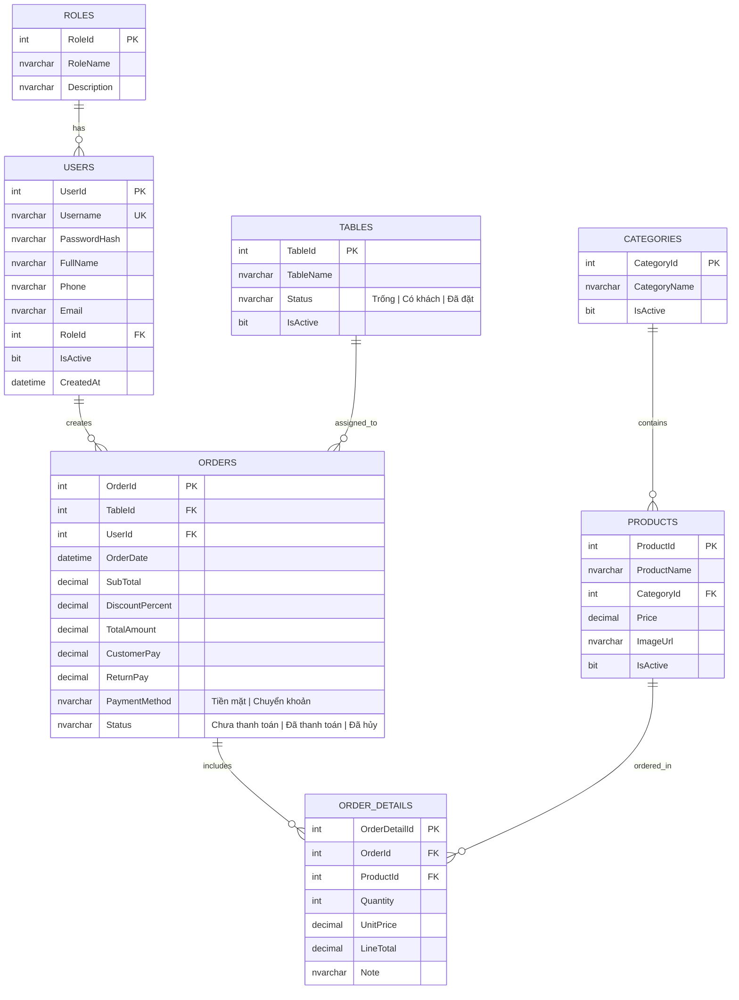

# DRINK SHOP MANAGEMENT SYSTEM
> **Hệ thống Quản lý Quán nước / Trà sữa / Cafe**  
> Dự án môn học: **Lập trình .NET** - Khoa Công nghệ Thông tin, Trường Đại học Điện Lực (EPU)

---

### 📋 THÔNG TIN DỰ ÁN & KIẾN TRÚC TỔNG QUAN
*(Drink Shop Management System, 3-Tier Architecture, Modern Flat UI, ADO.NET Direct SQL Connection & Real-time POS Billing)*

- **Học phần**: Lập trình .NET
- **Khoa / Trường**: Khoa Công nghệ Thông tin - Trường Đại học Điện Lực (EPU)
- **Chủ đề lựa chọn**: Hệ thống Quản lý Quán nước / Trà sữa / Cafe (Mô hình dịch vụ F&B - Bán hàng tại bàn & Mang về, Quản lý sơ đồ bàn trực quan, Danh mục thực đơn đồ uống, Hóa đơn thanh toán & Báo cáo doanh thu thời gian thực)
- **Người soạn thảo**: Nguyễn Thành Đạt (Trưởng nhóm / System Architect)
- **Người duyệt / Đồng chủ trì đề tài**: Nguyễn Trọng Hiếu & Lê Tuấn Anh
- **Kiến trúc cốt lõi**: Mô hình 3 lớp phân tầng chuẩn (*Presentation Layer* - GUI WinForms, *Business Logic Layer* - BLL, *Data Access Layer* - DAL, *Data Transfer Objects* - DTO), Kết nối trực tiếp Microsoft SQL Server bằng ADO.NET thuần (`SqlConnection`, `SqlCommand`, `SqlDataReader`, Parameterized Queries phòng chống SQL Injection tuyệt đối), Giao diện phẳng Modern Flat UI tối ưu trải nghiệm người dùng, Sơ đồ bàn trực quan đổi màu theo trạng thái thực tế (*Trống / Có khách / Đã đặt*), Phân quyền bảo mật 2 cấp độ (*Quản trị viên / Nhân viên thu ngân*), Báo cáo thống kê doanh thu & Biểu đồ Chart trực quan.
- **Tài liệu thiết kế chi tiết**: `README.md` (Phiên bản 1.0 - Hệ thống Quản lý Quán nước EPU)

---

### ☕ BỐI CẢNH & GIỚI THIỆU ĐỀ TÀI (INTRODUCTION)
Trong bối cảnh thị trường dịch vụ F&B (Food and Beverage) — đặc biệt là ngành kinh doanh đồ uống, trà sữa và cà phê — đang phát triển mạnh mẽ và cạnh tranh gay gắt, việc tối ưu hóa quy trình phục vụ và nâng cao độ chính xác trong vận hành đóng vai trò quyết định đến hiệu quả kinh doanh của mỗi cửa hàng.

Các phương thức quản lý truyền thống (ghi chép sổ sách thủ công, ghi nhớ miệng hoặc sử dụng các bảng tính rời rạc) thường bộc lộ nhiều hạn chế nghiêm trọng:
- ❌ **Dễ nhầm lẫn order**: Sai lệch định lượng đường/đá, ghi nhầm hoặc sót món của khách trong các khung giờ cao điểm.
- ❌ **Khó theo dõi trạng thái bàn**: Không nắm bắt trực quan bàn nào còn trống, bàn nào đang có khách hoặc đã đặt trước, gây bất tiện khi xếp chỗ và đổi/gộp bàn.
- ❌ **Rủi ro thất thoát doanh thu**: Tính toán sai tiền thừa, nhầm lẫn chiết khấu hoặc thiếu công cụ đối soát hóa đơn minh bạch giữa ca làm việc của nhân viên.
- ❌ **Thiếu báo cáo kinh doanh thời gian thực**: Người quản lý không có cái nhìn tổng quan về doanh thu theo ngày/tháng, không xác định được nhóm đồ uống nào đang bán chạy (Best-sellers) để lập kế hoạch nhập nguyên liệu.

Xuất phát từ thực tiễn trên, **Drink Shop Management System** được nhóm nghiên cứu và xây dựng như một **giải pháp phần mềm quản trị bán hàng toàn diện dành cho các quán đồ uống**. Ứng dụng được phát triển trên nền tảng **C# Windows Forms** với phong cách giao diện phẳng hiện đại (**Modern Flat UI**), kết nối trực tiếp cơ sở dữ liệu **Microsoft SQL Server** qua công nghệ **ADO.NET thuần**. Hệ thống giải quyết trọn vẹn chu trình bán hàng: từ tiếp nhận order, sơ đồ bàn trực quan đổi màu trạng thái, tính toán tự động & in hóa đơn tức thời, đến quản trị danh mục sản phẩm, phân quyền nhân viên và trực quan hóa doanh thu bằng biểu đồ.

---

## 📑 MỤC LỤC (TABLE OF CONTENTS)
- [1. 👥 THÀNH VIÊN THỰC HIỆN DỰ ÁN](#1--thành-viên-thực-hiện-dự-án)
- [2. 🎯 MA TRẬN TRÁCH NHIỆM (RACI MATRIX)](#2--ma-trận-trách-nhiệm-raci-matrix)
- [3. 📌 TỔNG QUAN DỰ ÁN](#3--tổng-quan-dự-án)
  - [3.1. Mục tiêu kỹ thuật & Trải nghiệm](#31-mục-tiêu-kỹ-thuật--trải-nghiệm)
- [4. 🏗️ KIẾN TRÚC HỆ THỐNG (3-TIER ARCHITECTURE)](#4-️-kiến-trúc-hệ-thống-3-tier-architecture)
- [5. 🗄️ THIẾT KẾ CƠ SỞ DỮ LIỆU (DATABASE SCHEMA)](#5-️-thiết-kế-cơ-sở-dữ-liệu-database-schema)
  - [5.1. Sơ đồ quan hệ thực thể (ERD)](#51-sơ-đồ-quan-hệ-thực-thể-erd)
- [6. 📅 KẾ HOẠCH TRIỂN KHAI THEO GIAI ĐOẠN (ROADMAP)](#6--kế-hoạch-triển-khai-theo-giai-đoạn-roadmap)
  - [📍 Giai đoạn 1: Khởi tạo Cơ sở dữ liệu & Cấu trúc Solution](#-giai-đoạn-1-khởi-tạo-cơ-sở-dữ-liệu--cấu-trúc-solution)
  - [📍 Giai đoạn 2: Thiết kế Khung giao diện hiện đại & Đăng nhập](#-giai-đoạn-2-thiết-kế-khung-giao-diện-hiện-đại--đăng-nhập)
  - [📍 Giai đoạn 3: Phân hệ Quản lý Danh mục & Sản phẩm (CRUD)](#-giai-đoạn-3-phân-hệ-quản-lý-danh-mục--sản-phẩm-crud)
  - [📍 Giai đoạn 4: Phân hệ Bán hàng POS & Quản lý Bàn nước](#-giai-đoạn-4-phân-hệ-bán-hàng-pos--quản-lý-bàn-nước-trọng-tâm)
  - [📍 Giai đoạn 5: Phân hệ Quản lý Hóa đơn & Nhân viên](#-giai-đoạn-5-phân-hệ-quản-lý-hóa-đơn--nhân-viên)
  - [📍 Giai đoạn 6: Phân hệ Báo cáo Doanh thu & Thống kê](#-giai-đoạn-6-phân-hệ-báo-cáo-doanh-thu--thống-kê)
  - [📍 Giai đoạn 7: Tối ưu hóa, Xử lý lỗi toàn cục & Đóng gói](#-giai-đoạn-7-tối-ưu-hóa-xử-lý-lỗi-toàn-cục--đóng-gói-hoàn-thiện)
- [7. 🎨 QUY CHUẨN ĐẶT TÊN CONTROL (NAMING CONVENTIONS)](#7--quy-chuẩn-đặt-tên-control-naming-conventions)
- [8. 🛠️ CÔNG NGHỆ & YÊU CẦU MÔI TRƯỜNG](#8-️-công-nghệ--yêu-cầu-môi-trường)
- [9. 📑 KHUNG ĐỀ CƯƠNG BÁO CÁO ĐỒ ÁN (PROJECT REPORT OUTLINE)](#9--khung-đề-cương-báo-cáo-đồ-án-project-report-outline)

---

## 1. 👥 THÀNH VIÊN THỰC HIỆN DỰ ÁN
1. **Nguyễn Thành Đạt** (Trưởng nhóm / Lead Developer / System Architect)
2. **Nguyễn Trọng Hiếu** (Core Developer / UI-UX & POS Specialist)
3. **Lê Tuấn Anh** (Core Developer / Business Logic & Reporting Specialist)

---

## 2. 🎯 MA TRẬN TRÁCH NHIỆM (RACI MATRIX)

> **Quy ước chuẩn quốc tế:**
> - **R (Responsible)**: Người trực tiếp thực hiện công việc.
> - **A (Accountable)**: Người chịu trách nhiệm chính, kiểm tra và nghiệm thu sản phẩm.
> - **C (Consulted)**: Người hỗ trợ, cố vấn chuyên môn, phối hợp thực hiện.
> - **I (Informed)**: Người được thông báo tiến độ, kết quả công việc.

| STT | Giai đoạn / Module chức năng | Nguyễn Thành Đạt | Nguyễn Trọng Hiếu | Lê Tuấn Anh |
| :---: | :--- | :---: | :---: | :---: |
| **1** | **Khởi tạo kiến trúc 3 lớp & Database (`DrinkShopDB`)** | **A / R** | C | C |
| **2** | **Xây dựng Data Access Layer (`DatabaseHelper.cs`) & DTOs** | **A / R** | I | I |
| **3** | **Thiết kế UI Khung Master (`FrmMain`, Sidebar điều hướng)** | A | **R** | C |
| **4** | **Phân hệ Đăng nhập, Xác thực & Phân quyền (`FrmLogin`)** | **A / R** | C | I |
| **5** | **Phân hệ Quản lý Danh mục & Sản phẩm (`FrmCategory`, `FrmProduct`)** | A | C | **R** |
| **6** | **Phân hệ Sơ đồ Bàn & Bán hàng POS (`FrmTable`, `FrmPOS`)** | A | **R** | C |
| **7** | **Phân hệ Quản lý Hóa đơn & In ấn (`FrmInvoice`, `PrintPreview`)** | A | **R** | C |
| **8** | **Phân hệ Quản lý Nhân viên & Tài khoản (`FrmEmployee`)** | A | C | **R** |
| **9** | **Phân hệ Báo cáo Doanh thu & Dashboard Chart (`FrmStatistic`, `FrmDashboard`)** | A | C | **R** |
| **10**| **Xử lý ngoại lệ toàn cục, Tối ưu hóa & Kiểm thử tích hợp** | **A / R** | R | R |
| **11**| **Đóng gói phần mềm & Hoàn thiện báo cáo đồ án** | **A** | R | R |

---

## 3. 📌 TỔNG QUAN DỰ ÁN
**Drink Shop Management System** là ứng dụng desktop xây dựng trên nền tảng **C# Windows Forms** kết hợp cơ sở dữ liệu **Microsoft SQL Server**, giao tiếp trực tiếp qua công nghệ **ADO.NET** (thuần parameterized queries / stored procedures, không dùng ORM, không dùng mock data).

### 3.1. Mục tiêu kỹ thuật & Trải nghiệm
- **Kiến trúc phân lớp chuẩn (3-Layer Architecture)**: Tách bạch rõ ràng giữa Giao diện (Presentation / GUI) - Nghiệp vụ (Business Logic Layer - BLL) - Truy cập dữ liệu (Data Access Layer - DAL) và Đối tượng truyền tải (DTO/Entities).
- **Giao diện người dùng (UI/UX) hiện đại**: Tối ưu màu sắc hiện đại (Flat UI, Dark/Light accents, bo góc, icon trực quan), sơ đồ bàn tương tác trực quan theo màu trạng thái, thẻ sản phẩm trực quan.
- **Tính toàn vẹn dữ liệu**: Ràng buộc toàn vẹn cơ sở dữ liệu (Primary Key, Foreign Key, Check Constraints, Cascading Rules) xử lý chặt chẽ tại SQL Server.
- **Bảo mật & Hiệu năng**: Chống tấn công SQL Injection bằng `SqlParameter`, mã hóa mật khẩu, quản lý kết nối `SqlConnection` tối ưu qua `using` blocks.

---

## 4. 🏗️ KIẾN TRÚC HỆ THỐNG (3-TIER ARCHITECTURE)

```
DrinkShopManagement/
│
├── DrinkShop.DTO/                # Data Transfer Objects (Entity models)
│   ├── RoleDTO.cs
│   ├── UserDTO.cs
│   ├── CategoryDTO.cs
│   ├── ProductDTO.cs
│   ├── TableDTO.cs
│   ├── OrderDTO.cs
│   └── OrderDetailDTO.cs
│
├── DrinkShop.DAL/                # Data Access Layer (ADO.NET)
│   ├── DatabaseHelper.cs         # Mở kết nối, thực thi Command/Reader/Scalar
│   ├── RoleDAL.cs
│   ├── UserDAL.cs
│   ├── CategoryDAL.cs
│   ├── ProductDAL.cs
│   ├── TableDAL.cs
│   ├── OrderDAL.cs
│   └── StatisticDAL.cs
│
├── DrinkShop.BLL/                # Business Logic Layer (Xử lý nghiệp vụ & Validate)
│   ├── AuthBLL.cs
│   ├── UserBLL.cs
│   ├── CategoryBLL.cs
│   ├── ProductBLL.cs
│   ├── TableBLL.cs
│   ├── OrderBLL.cs
│   └── StatisticBLL.cs
│
└── DrinkShop.GUI/                # Presentation Layer (WinForms UI)
    ├── Program.cs
    ├── App.config                # Chuỗi kết nối ConnectionString
    ├── Common/                   # Constants, Session, Helper vẽ UI/Format tiền tệ
    ├── Forms/
    │   ├── FrmLogin.cs           # Màn hình đăng nhập
    │   ├── FrmMain.cs            # Màn hình chính (Dashboard Shell & Sidebar điều hướng)
    │   ├── FrmDashboard.cs       # Thống kê tổng quan thẻ KPI
    │   ├── FrmPOS.cs             # Màn hình bán hàng, chọn bàn, chọn món
    │   ├── FrmProduct.cs         # Quản lý danh sách đồ uống & upload ảnh
    │   ├── FrmCategory.cs        # Quản lý danh mục đồ uống
    │   ├── FrmTable.cs           # Quản lý sơ đồ bàn
    │   ├── FrmInvoice.cs         # Tra cứu & in lại hóa đơn
    │   ├── FrmEmployee.cs        # Quản lý nhân viên & phân quyền
    │   └── FrmStatistic.cs       # Báo cáo doanh thu & biểu đồ
    └── UserControls/             # Các thẻ con tùy biến (Card sản phẩm, nút bàn)
```

---

## 5. 🗄️ THIẾT KẾ CƠ SỞ DỮ LIỆU (DATABASE SCHEMA)

Cơ sở dữ liệu: `DrinkShopDB` trên Microsoft SQL Server.

### 5.1. Sơ đồ quan hệ thực thể (ERD)



---

## 6. 📅 KẾ HOẠCH TRIỂN KHAI THEO GIAI ĐOẠN (ROADMAP)

### 📍 Giai đoạn 1: Khởi tạo Cơ sở dữ liệu & Cấu trúc Solution
- [ ] **1.1.** Cài đặt Database `DrinkShopDB` trên SQL Server với kịch bản script đầy đủ bảng, khóa chính, khóa ngoại, chỉ mục (Index) và dữ liệu mẫu khởi đầu (Tài khoản Admin, Danh mục đồ uống, Bàn mẫu).
- [ ] **1.2.** Khởi tạo Visual Studio Solution theo mô hình 3 lớp (`DrinkShop.DTO`, `DrinkShop.DAL`, `DrinkShop.BLL`, `DrinkShop.GUI`).
- [ ] **1.3.** Cấu hình `App.config` chứa chuỗi kết nối an toàn.
- [ ] **1.4.** Xây dựng lớp `DatabaseHelper.cs` (ADO.NET chuẩn, mở/đóng kết nối tự động, transaction, chống SQL Injection).
- [ ] **Kiểm thử Giai đoạn 1:** Chạy đoạn mã kiểm tra ping kết nối SQL Server thành công và đọc dữ liệu kiểm chứng.

### 📍 Giai đoạn 2: Thiết kế Khung giao diện hiện đại & Đăng nhập
- [ ] **2.1.** Xây dựng phong cách UI chuẩn (Bảng màu hiện đại, Segoe UI, thiết kế bo góc, hiệu ứng hover nút bấm).
- [ ] **2.2.** Thiết kế Form Đăng nhập (`FrmLogin`):
  - Nhập tài khoản, mật khẩu (ẩn/hiện mật khẩu).
  - Kết nối xác thực từ CSDL qua `AuthBLL` -> `UserDAL`.
  - Phân quyền theo vai trò (Quản trị viên / Nhân viên thu ngân) và lưu phiên đăng nhập (`UserSession`).
- [ ] **2.3.** Thiết kế Giao diện Khung chính (`FrmMain`):
  - Sidebar điều hướng (Dashboard, Bán hàng, Sản phẩm, Danh mục, Bàn, Hóa đơn, Nhân viên, Thống kê).
  - Header hiển thị ngày giờ, tên nhân viên đăng nhập, nút đăng xuất, thu nhỏ/tắt ứng dụng.
  - Vùng hiển thị động (`Content Panel`) để nhúng các Form con mượt mà, không bị giật lag.
- [ ] **Kiểm thử Giai đoạn 2:** Đăng nhập với tài khoản Admin và Nhân viên, kiểm tra hiển thị đúng thông tin và điều hướng sidebar trơn tru.

### 📍 Giai đoạn 3: Phân hệ Quản lý Danh mục & Sản phẩm (CRUD)
- [ ] **3.1.** Xây dựng Form Quản lý Danh mục (`FrmCategory`):
  - Xem danh sách DataGridView, Thêm, Sửa, Xóa (cập nhật trạng thái `IsActive = 0`), Tìm kiếm realtime.
- [ ] **3.2.** Xây dựng Form Quản lý Sản phẩm (`FrmProduct`):
  - Hiển thị danh sách đồ uống kèm giá tiền (format tiền tệ VNĐ `#,##0 đ`), danh mục liên kết.
  - Chức năng chọn ảnh minh họa đồ uống (lưu trữ đường dẫn hoặc thư mục `Resources/Images`).
  - Lọc theo danh mục, tìm kiếm theo tên món.
- [ ] **Kiểm thử Giai đoạn 3:** Thêm mới 1 danh mục (ví dụ: "Trà sữa", "Cà phê"), thêm 3 món nước mới, sửa giá và kiểm tra cập nhật chuẩn trong SQL Server.

### 📍 Giai đoạn 4: Phân hệ Bán hàng POS & Quản lý Bàn nước (Trọng tâm)
- [ ] **4.1.** Thiết kế Form Quản lý Bàn (`FrmTable`): Thêm bàn, đổi trạng thái bàn, khu vực.
- [ ] **4.2.** Thiết kế Giao diện POS Bán hàng (`FrmPOS`):
  - Cột 1: Sơ đồ bàn trực quan hiển thị theo màu sắc (Xanh: Trống, Đỏ/Cam: Đang có khách, Vàng: Đã đặt trước).
  - Cột 2: Danh sách món nước hiển thị dạng Grid Card (có hình ảnh, tên món, giá tiền), bấm vào thẻ để thêm vào hóa đơn.
  - Cột 3: Hóa đơn bàn đang chọn: Tăng/giảm số lượng, xóa món, nhập ghi chú (ví dụ: "Ít đường, nhiều đá").
- [ ] **4.3.** Nghiệp vụ tính tiền: Tự động cộng tổng tiền, áp dụng chiết khấu %, tính tiền thừa khi khách trả.
- [ ] **4.4.** Nghiệp vụ Bàn: Chuyển bàn, gộp bàn khi khách đổi chỗ.
- [ ] **4.5.** Chức năng Thanh toán & In hóa đơn: Cập nhật trạng thái đơn, giải phóng bàn về "Trống", xuất preview phiếu tính tiền.
- [ ] **Kiểm thử Giai đoạn 4:** Chọn bàn -> Gọi 2 món -> Tăng giảm số lượng -> Nhập tiền khách trả -> Bấm Thanh toán -> Kiểm tra trạng thái bàn và dữ liệu đơn hàng trong bảng `Orders` & `OrderDetails`.

### 📍 Giai đoạn 5: Phân hệ Quản lý Hóa đơn & Nhân viên
- [ ] **5.1.** Quản lý Lịch sử Hóa đơn (`FrmInvoice`):
  - Tìm kiếm hóa đơn theo khoảng ngày, theo nhân viên tạo, theo trạng thái.
  - Xem chi tiết từng món trong hóa đơn cũ.
  - In lại phiếu tính tiền khi cần.
- [ ] **5.2.** Quản lý Tài khoản Nhân viên (`FrmEmployee`):
  - CRUD nhân viên: Họ tên, SĐT, Email, Tên tài khoản, Mật khẩu, Vai trò (Admin / Thu ngân).
  - Khóa/Mở khóa tài khoản nhân viên.
  - Phân quyền nghiệp vụ (Nhân viên không được xóa hóa đơn hay xem quản lý nhân viên).
- [ ] **Kiểm thử Giai đoạn 5:** Tạo 1 tài khoản nhân viên mới, đăng nhập tài khoản đó kiểm tra quyền hạn có bị giới hạn đúng chuẩn hay không.

### 📍 Giai đoạn 6: Phân hệ Báo cáo Doanh thu & Thống kê
- [ ] **6.1.** Màn hình Dashboard Tổng quan (`FrmDashboard`):
  - Các thẻ KPI: Doanh thu hôm nay, Số đơn hôm nay, Số món đã bán, Bàn đang phục vụ.
- [ ] **6.2.** Màn hình Thống kê Báo cáo (`FrmStatistic`):
  - Báo cáo doanh thu theo ngày / tuần / tháng / năm hoặc khoảng ngày tùy chọn.
  - Danh sách Top 5 đồ uống bán chạy nhất (Best-sellers).
  - Biểu đồ trực quan doanh thu (Chart control).
  - Xuất dữ liệu báo cáo ra file Excel.
- [ ] **Kiểm thử Giai đoạn 6:** Thử nghiệm tạo nhiều đơn hàng và đối soát số liệu biểu đồ hiển thị với câu lệnh `SUM()` trong SQL Server.

### 📍 Giai đoạn 7: Tối ưu hóa, Xử lý lỗi toàn cục & Đóng gói hoàn thiện
- [ ] **7.1.** Bắt lỗi tập trung (Global Exception Handling) tránh crash ứng dụng.
- [ ] **7.2.** Tối ưu trải nghiệm: Thêm phím tắt (F1, F2,... Enter để tìm kiếm), kiểm tra ràng buộc nhập liệu (Validation messages thân thiện bằng tiếng Việt).
- [ ] **7.3.** Đóng gói chương trình và chuẩn bị tài liệu báo cáo đồ án.

---

## 7. 🎨 QUY CHUẨN ĐẶT TÊN CONTROL (NAMING CONVENTIONS)

Để cả 3 thành viên phối hợp code đồng bộ, chuyên nghiệp và chuẩn quốc tế, toàn bộ tên Control tuân thủ nghiêm ngặt tiền tố (Prefix) viết tắt và định danh hoàn toàn bằng **tiếng Anh**:

| Loại Control | Tiền tố (Prefix) | Ví dụ tên Control (Naming Convention) | Ý nghĩa / Mục đích sử dụng |
| :--- | :---: | :--- | :--- |
| **Form** | `Frm` | `FrmLogin`, `FrmMain`, `FrmPOS`, `FrmProduct`, `FrmCategory`, `FrmTable`, `FrmInvoice`, `FrmEmployee`, `FrmStatistic` | Cửa sổ giao diện chức năng |
| **Button** | `btn` | `btnAdd`, `btnEdit`, `btnDelete`, `btnSave`, `btnCancel`, `btnCheckout`, `btnPrint`, `btnSearch`, `btnRefresh` | Nút bấm thao tác |
| **TextBox** | `txt` | `txtUsername`, `txtPassword`, `txtProductName`, `txtUnitPrice`, `txtSearch`, `txtCustomerPay`, `txtPhone`, `txtEmail` | Hộp nhập dữ liệu dạng chuỗi văn bản |
| **ComboBox** | `cbo` | `cboCategory`, `cboTable`, `cboRole`, `cboPaymentMethod`, `cboStatusFilter` | Hộp danh sách thả xuống chọn 1 giá trị |
| **DataGridView** | `dgv` | `dgvProducts`, `dgvCategories`, `dgvTables`, `dgvInvoices`, `dgvOrderDetails`, `dgvEmployees` | Lưới bảng hiển thị danh sách dữ liệu từ CSDL |
| **Label** | `lbl` | `lblTitle`, `lblTotalAmount`, `lblSubTotal`, `lblDiscount`, `lblReturnPay`, `lblEmployeeName`, `lblCurrentDate` | Nhãn hiển thị thông tin tĩnh hoặc động |
| **PictureBox** | `pic` | `picProductImage`, `picLogo`, `picAvatar`, `picPreview` | Khung hiển thị hình ảnh |
| **Panel** | `pnl` | `pnlSidebar`, `pnlHeader`, `pnlContent`, `pnlBillSummary`, `pnlActions` | Khung vùng chứa phân chia bố cục giao diện |
| **FlowLayoutPanel**| `flp` | `flpTableList`, `flpProductList`, `flpCategoryFilter` | Khung vùng chứa sắp xếp thẻ/nút động tự co giãn |
| **DateTimePicker** | `dtp` | `dtpFromDate`, `dtpToDate`, `dtpOrderDate`, `dtpBirthDate` | Bộ chọn ngày giờ |
| **NumericUpDown** | `nud` | `nudQuantity`, `nudDiscountPercent` | Hộp chọn số lượng, tỉ lệ % tăng/giảm |

---

## 8. 🛠️ CÔNG NGHỆ & YÊU CẦU MÔI TRƯỜNG
- **Hệ điều hành**: Windows 10 / 11
- **Công cụ phát triển**: Visual Studio 2022 (với Workload *.NET desktop development*)
- **Ngôn ngữ**: C# (.NET Framework 4.8 hoặc .NET 8.0/10.0 Windows Forms)
- **Hệ quản trị CSDL**: Microsoft SQL Server 2019 / 2022 / SQL Server Express
- **Công cụ quản lý DB**: SQL Server Management Studio (SSMS)

---

## 9. 📑 KHUNG ĐỀ CƯƠNG BÁO CÁO ĐỒ ÁN (PROJECT REPORT OUTLINE)

> Cấu trúc chuẩn theo mẫu báo cáo đồ án môn học **Lập trình .NET** - Trường Đại học Điện Lực (EPU):

### 📄 CÁC PHẦN ĐẦU (FRONT MATTER)
- **Trang bìa chính & Trang phụ bìa** (Tên trường, khoa CNTT, tên đề tài, GVHD, SV thực hiện)
- **Lời cảm ơn**
- **Nhận xét của Giảng viên hướng dẫn**
- **Mục lục báo cáo**
- **Danh mục ký hiệu & Chữ viết tắt** (ADO.NET, CRUD, BLL, DAL, DTO, GUI, ERD, POS,...)
- **Danh mục Bảng biểu**
- **Danh mục Hình ảnh & Biểu đồ**

---

### 📖 CHƯƠNG 1: TỔNG QUAN VÀ KHẢO SÁT HIỆN TRẠNG
- **1.1. Đặt vấn đề và Tính cấp thiết của đề tài**
  - Thực trạng quản lý thủ công (ghi chép sổ sách, sai sót khi tính tiền, thất thoát doanh thu).
  - Nhu cầu ứng dụng CNTT vào tự động hóa vận hành quán nước/cafe.
- **1.2. Mục tiêu và Phạm vi nghiên cứu**
  - *Mục tiêu*: Xây dựng phần mềm quản lý quán nước hoàn chỉnh, giao diện hiện đại, dễ thao tác.
  - *Phạm vi*: Áp dụng cho mô hình quán vừa và nhỏ với quy trình gọi món tại bàn, thanh toán tại quầy.
- **1.3. Khảo sát quy trình nghiệp vụ thực tế**
  - Quy trình đón khách và chọn bàn.
  - Quy trình gọi món (Order), thêm topping/ghi chú món.
  - Quy trình chuyển bàn, gộp bàn.
  - Quy trình thanh toán hóa đơn và in phiếu tính tiền.
  - Quy trình kiểm kê cuối ngày và báo cáo doanh thu.
- **1.4. Phân tích yêu cầu bài toán**
  - *Yêu cầu chức năng*: Đăng nhập, POS bán hàng, quản lý danh mục/sản phẩm, quản lý bàn, quản lý nhân viên, thống kê.
  - *Yêu cầu phi chức năng*: Giao diện đẹp, thao tác dưới 3 click, bảo mật mật khẩu, chống SQL Injection, tốc độ phản hồi < 1s.

---

### 📖 CHƯƠNG 2: CƠ SỞ LÝ THUYẾT VÀ CÔNG NGHỆ ÁP DỤNG
- **2.1. Nền tảng .NET và Ngôn ngữ lập trình C#**
  - Đặc điểm, tính năng mạnh mẽ và tính hướng đối tượng của C#.
- **2.2. Công nghệ giao diện Windows Forms (WinForms)**
  - Cơ chế Event-driven Programming trong WinForms.
  - Phong cách thiết kế Flat Modern UI (phân phối màu sắc, hiệu ứng tương tác, bo góc).
- **2.3. Hệ quản trị Cơ sở dữ liệu Microsoft SQL Server**
  - Vai trò của RDBMS, tính toàn vẹn dữ liệu qua Foreign Key và Transactions.
- **2.4. Công nghệ kết nối dữ liệu ADO.NET**
  - Kiến trúc ADO.NET kết nối trực tiếp (`SqlConnection`, `SqlCommand`, `SqlDataReader`, `SqlDataAdapter`).
  - Kỹ thuật truy vấn an toàn bằng Parameterized Queries phòng chống SQL Injection.
- **2.5. Kiến trúc phân lớp chuẩn (3-Tier Architecture)**
  - Tầng trình diễn (Presentation Layer - GUI).
  - Tầng xử lý nghiệp vụ (Business Logic Layer - BLL).
  - Tầng truy cập dữ liệu (Data Access Layer - DAL).
  - Tầng đối tượng truyền tải (Data Transfer Object - DTO).

---

### 📖 CHƯƠNG 3: PHÂN TÍCH VÀ THIẾT KẾ HỆ THỐNG
- **3.1. Phân tích chức năng hệ thống**
  - Biểu đồ Use Case tổng quát toàn hệ thống.
  - Biểu đồ Use Case phân rã cho từng tác nhân (Quản trị viên / Nhân viên thu ngân).
  - Đặc tả chi tiết các Use Case trọng tâm (Đăng nhập, Gọi món tại bàn, Thanh toán hóa đơn).
- **3.2. Thiết kế Cơ sở dữ liệu**
  - Sơ đồ quan hệ thực thể (ERD).
  - Chuyển đổi mô hình ERD sang mô hình quan hệ (Relational Schema).
  - Đặc tả chi tiết các bảng (`Roles`, `Users`, `Categories`, `Products`, `Tables`, `Orders`, `OrderDetails`).
  - Các ràng buộc toàn vẹn, chỉ mục (Index) tối ưu hóa tốc độ truy vấn.
- **3.3. Thiết kế luồng xử lý (Sequence Diagrams)**
  - Biểu đồ tuần tự ca sử dụng: Đăng nhập hệ thống.
  - Biểu đồ tuần tự ca sử dụng: Đặt món & Lưu order vào bàn.
  - Biểu đồ tuần tự ca sử dụng: Thanh toán hóa đơn & In hóa đơn.
- **3.4. Thiết kế Giao diện người dùng (Wireframe / Mockup)**
  - Bố cục Master Layout: Header + Sidebar + Dynamic Content Host.
  - Thiết kế màn hình POS bán hàng chia 3 cột trực quan.

---

### 📖 CHƯƠNG 4: CÀI ĐẶT VÀ THỰC NGHIỆM HỆ THỐNG
- **4.1. Môi trường triển khai và Cấu hình kết nối**
  - Hướng dẫn cấu hình chuỗi kết nối trong `App.config`.
  - Cài đặt lớp dùng chung `DatabaseHelper.cs`.
- **4.2. Cài đặt các tầng nghiệp vụ (DAL & BLL)**
  - Hiện thực hóa các phương thức CRUD và kiểm tra logic dữ liệu.
- **4.3. Hiện thực hóa các phân hệ giao diện**
  - 4.3.1. Phân hệ Đăng nhập & Lưu phiên làm việc (`FrmLogin`, `UserSession`).
  - 4.3.2. Phân hệ Khung giao diện chính & Thẻ KPI Dashboard (`FrmMain`, `FrmDashboard`).
  - 4.3.3. Phân hệ Quản lý Danh mục & Sản phẩm đồ uống (`FrmCategory`, `FrmProduct`).
  - 4.3.4. Phân hệ Bán hàng POS & Sơ đồ bàn thời gian thực (`FrmPOS`, `FrmTable`).
  - 4.3.5. Phân hệ Quản lý Lịch sử Hóa đơn & In ấn (`FrmInvoice`).
  - 4.3.6. Phân hệ Quản lý Tài khoản & Phân quyền Nhân viên (`FrmEmployee`).
  - 4.3.7. Phân hệ Báo cáo Doanh thu & Biểu đồ Chart (`FrmStatistic`).
- **4.4. Kiểm thử hệ thống (Software Testing)**
  - Xây dựng bảng kịch bản kiểm thử (Test Cases) cho từng chức năng.
  - Kết quả kiểm thử thực tế và đánh giá độ ổn định.

---

### 📖 CHƯƠNG 5: KẾT LUẬN VÀ HƯỚNG PHÁT TRIỂN
- **5.1. Kết quả đạt được**
  - Mức độ hoàn thành các chức năng theo yêu cầu đề bài.
  - Giao diện đạt độ thẩm mỹ, hiện đại và tính ứng dụng thực tế.
- **5.2. Hạn chế của hệ thống**
  - Hệ thống mới chạy trên nền Desktop Windows nội bộ (LAN).
- **5.3. Hướng phát triển trong tương lai**
  - Tích hợp cổng thanh toán trực tuyến / VietQR sinh mã động theo số tiền hóa đơn.
  - Mở rộng phân hệ Quản lý kho nguyên vật liệu và định lượng công thức đồ uống.
  - Xây dựng Mobile App cho nhân viên phục vụ order trực tiếp tại bàn.

---

### 📚 TÀI LIỆU THAM KHẢO & PHỤ LỤC
- Các tài liệu giáo trình Lập trình .NET, tài liệu Microsoft Learn về C# & ADO.NET.
- Phụ lục: Mã nguồn các Stored Procedures chính và kịch bản cơ sở dữ liệu.
