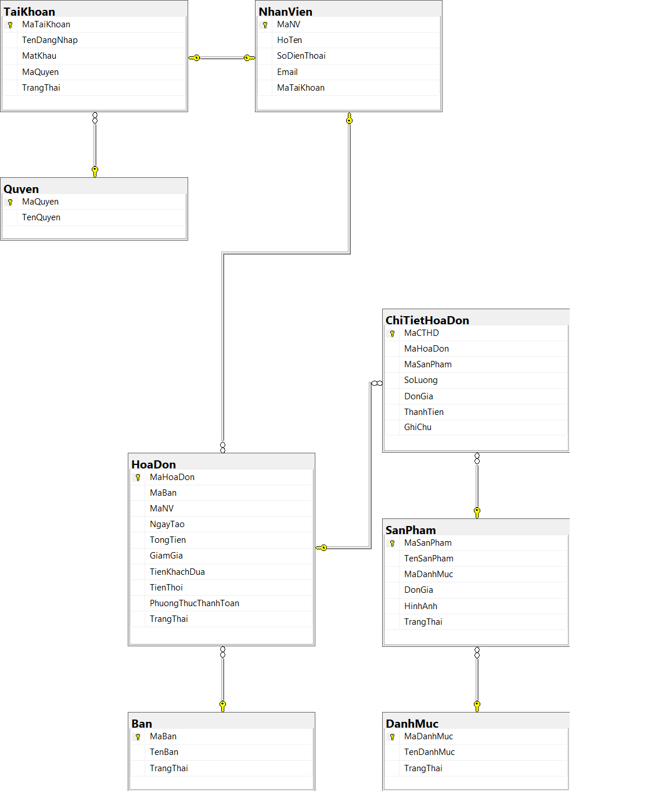
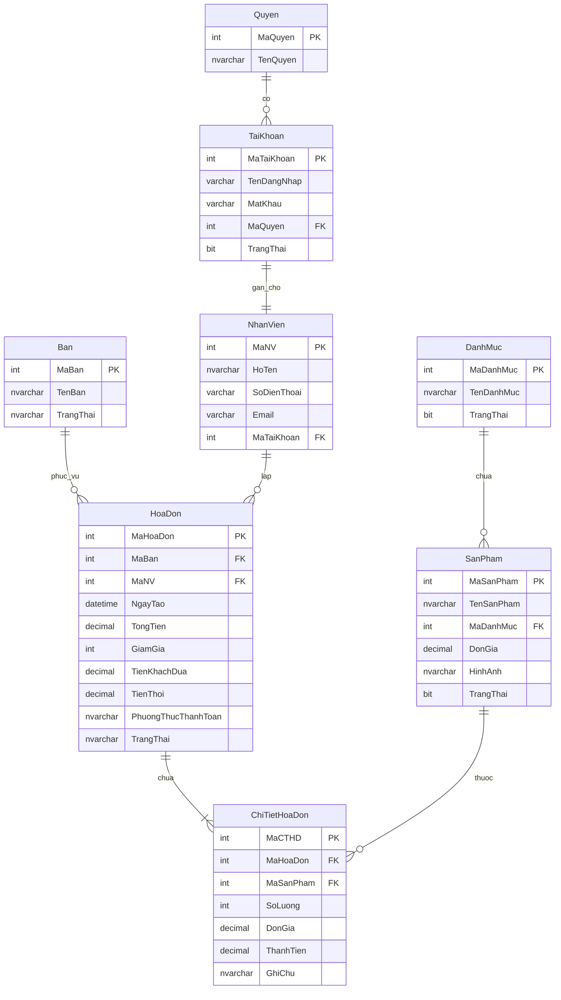

# Drink Shop Database Design

Tài liệu này mô tả thiết kế cơ sở dữ liệu của dự án **Drink Shop Management System** (Hệ thống Quản lý Quán nước / Trà sữa / Cà phê). Đây là tài liệu kỹ thuật đi kèm với sơ đồ `ERD.png` và các kịch bản SQL khởi tạo trong thư mục `Database/`.

> **Phạm vi:** 8 bảng cốt lõi theo thiết kế đã thống nhất của dự án. Tài liệu này không thay thế `README.md` ở thư mục gốc của repository.

---

## 1. Thông tin chung

| Thuộc tính | Giá trị |
| :--- | :--- |
| **Database** | `DrinkShopDB` |
| **DBMS** | Microsoft SQL Server 2019 / 2022 / SQL Server Express |
| **Storage Engine** | Relational Database Engine |
| **Character Set / Collation** | `Vietnamese_CI_AS` (Hỗ trợ tiếng Việt Unicode, không phân biệt hoa/thường, có phân biệt dấu) |
| **Mô hình** | Relational Database (Cơ sở dữ liệu quan hệ chuẩn hóa 3NF) |
| **Số bảng nghiệp vụ** | 8 bảng cốt lõi |

---

## 2. Danh sách bảng

| STT | Bảng | Mục đích |
| :---: | :--- | :--- |
| 1 | `Quyen` | Quản lý danh mục quyền hạn và vai trò người dùng hệ thống (`Admin`, `Cashier`). |
| 2 | `TaiKhoan` | Quản lý tài khoản đăng nhập, mật khẩu mã hóa (hash) và trạng thái hoạt động. |
| 3 | `NhanVien` | Quản lý hồ sơ nhân viên, thông tin liên lạc và liên kết 1-1 với tài khoản. |
| 4 | `DanhMuc` | Quản lý danh mục phân loại đồ uống (Cà phê, Trà sữa, Trà trái cây...). |
| 5 | `SanPham` | Quản lý thông tin đồ uống, đơn giá niêm yết, đường dẫn ảnh và trạng thái phục vụ. |
| 6 | `Ban` | Quản lý sơ đồ bàn phục vụ và trạng thái bàn (*Trống*, *Có khách*, *Đã đặt*). |
| 7 | `HoaDon` | Quản lý thông tin chung của hóa đơn bán hàng POS (thời gian, tổng tiền, giảm giá, trạng thái). |
| 8 | `ChiTietHoaDon` | Quản lý chi tiết các món nước trong từng hóa đơn kèm số lượng, đơn giá và ghi chú định lượng. |

---

## 3. Quan hệ giữa các bảng và Sơ đồ ERD

### Sơ đồ quan hệ thực thể (ERD Diagram):





### Bảng đối chiếu quan hệ khóa ngoại:

| Bảng cha | Bảng con | Khóa ngoại | Quan hệ |
| :--- | :--- | :--- | :--- |
| `Quyen` | `TaiKhoan` | `TaiKhoan.MaQuyen` | Một quyền có thể gán cho nhiều tài khoản; một tài khoản thuộc về một quyền. |
| `TaiKhoan` | `NhanVien` | `NhanVien.MaTaiKhoan` | Một nhân viên liên kết tối đa một tài khoản đăng nhập (`UNIQUE`). |
| `DanhMuc` | `SanPham` | `SanPham.MaDanhMuc` | Một danh mục chứa nhiều sản phẩm món nước. |
| `Ban` | `HoaDon` | `HoaDon.MaBan` | Một bàn có thể phát sinh nhiều hóa đơn bán hàng theo thời gian. |
| `NhanVien` | `HoaDon` | `HoaDon.MaNV` | Một nhân viên thu ngân có thể lập nhiều hóa đơn bán hàng. |
| `HoaDon` | `ChiTietHoaDon` | `ChiTietHoaDon.MaHoaDon` | Một hóa đơn có nhiều dòng chi tiết các món đã gọi. |
| `SanPham` | `ChiTietHoaDon` | `ChiTietHoaDon.MaSanPham` | Một sản phẩm có thể xuất hiện trên nhiều dòng chi tiết hóa đơn. |

### Mô hình Header -- Detail:
Nghiệp vụ lập order và thanh toán bán hàng tại bàn sử dụng mô hình Header -- Detail chuẩn mực:
- **`HoaDon` (Header)**: Lưu trữ thông tin chung của toàn bộ giao dịch (bàn phục vụ, nhân viên lập đơn, ngày giờ tạo, tổng tiền, chiết khấu/giảm giá, tiền khách đưa, tiền thừa trả lại, phương thức thanh toán và trạng thái hóa đơn).
- **`ChiTietHoaDon` (Detail)**: Lưu từng món nước cụ thể được gọi (mã món, số lượng, đơn giá tại thời điểm lập đơn, thành tiền và ghi chú định lượng riêng như *"70% đường, 50% đá, thêm trân châu"*).

> **Ý nghĩa**: Việc phân tách thành Header -- Detail giúp tránh trùng lặp dữ liệu chung của hóa đơn trên từng dòng sản phẩm, đồng thời ghi nhận độc lập đơn giá tại thời điểm bán (không bị ảnh hưởng nếu sản phẩm sau này đổi giá).

---

## 4. Danh mục sản phẩm chuẩn

Bảng `DanhMuc` sử dụng 6 mã và tên danh mục chuẩn đã được nhóm thống nhất:

| Mã tham chiếu | Tên danh mục | Sản phẩm demo tiêu biểu | Đơn giá mẫu |
| :---: | :--- | :--- | :---: |
| **DM01** | Cà phê | Cà phê đen, Cà phê sữa, Bạc xỉu | 25.000 - 32.000 đ |
| **DM02** | Trà sữa | Trà sữa truyền thống, Trà sữa trân châu đường đen, Trà sữa matcha | 35.000 - 42.000 đ |
| **DM03** | Trà trái cây | Trà đào cam sả, Trà vải, Trà chanh mật ong | 30.000 - 38.000 đ |
| **DM04** | Đá xay | Cookie đá xay, Matcha đá xay | 45.000 đ |
| **DM05** | Nước ép & Sinh tố | Sinh tố bơ, Nước ép cam | 38.000 - 45.000 đ |
| **DM06** | Bánh & Topping | Bánh Tiramisu, Trân châu đen | 10.000 - 35.000 đ |

*Lưu ý: Không tự ý thay đổi tên hoặc xóa các danh mục mặc định để tránh làm sai lệch dữ liệu thử nghiệm của nhóm.*

---

## 5. Quy tắc nghiệp vụ liên quan đến bán hàng & bàn nước

### Lập Order & Gọi món:
1. Thu ngân chọn bàn phục vụ trên sơ đồ bàn (ví dụ: *Bàn 01*).
2. Kiểm tra trạng thái bàn:
   - Nếu bàn đang có khách: Hệ thống tải lại danh sách các món nước đã gọi trước đó để gọi thêm.
   - Nếu bàn trống: Khởi tạo hóa đơn mới cho bàn đó.
3. Chọn món nước từ thực đơn, điều chỉnh số lượng và thêm ghi chú định lượng (đường/đá/topping).
4. Nhấn **Lưu Order**: Tạo bản ghi trong `HoaDon` (trạng thái `'Chưa thanh toán'`) và các dòng `ChiTietHoaDon`, đồng thời cập nhật `Ban.TrangThai = N'Có khách'`.

### Chuyển bàn & Gộp bàn:
- **Chuyển bàn**: Cập nhật `MaBan` mới cho hóa đơn đang phục vụ; chuyển trạng thái bàn cũ thành `'Trống'`, bàn mới thành `'Có khách'`.
- **Gộp bàn**: Chuyển các dòng chi tiết món từ hóa đơn bàn A sang hóa đơn bàn B, hủy hóa đơn bàn A và giải phóng bàn A về trạng thái `'Trống'`.

### Thanh toán:
1. Thu ngân chọn bàn cần thanh toán, kiểm tra lại danh sách món và tổng tiền.
2. Áp dụng giảm giá / chiết khấu (nếu có).
3. Nhập số tiền khách đưa -> hệ thống tự tính số tiền thừa trả khách.
4. Chọn phương thức thanh toán (*Tiền mặt* hoặc *Chuyển khoản QR*).
5. Khi xác nhận thanh toán thành công:
   - Cập nhật `HoaDon.TrangThai = N'Đã thanh toán'`.
   - Cập nhật `Ban.TrangThai = N'Trống'` để sẵn sàng đón lượt khách tiếp theo.

### Database Transaction (Giao dịch SQL):
Thao tác hoàn tất thanh toán hóa đơn và giải phóng trạng thái bàn **bắt buộc** phải được thực thi trong cùng một giao dịch cơ sở dữ liệu (`SqlTransaction`):
- **Tất cả thao tác thành công**: Thực hiện `COMMIT`.
- **Có bất kỳ thao tác nào thất bại**: Lập tức gọi `ROLLBACK`.

> **Mục tiêu**: Đảm bảo tính nhất quán (ACID), tránh lỗi hóa đơn đã ghi nhận thanh toán nhưng bàn vẫn treo ở trạng thái 'Có khách', hoặc bàn bị giải phóng nhưng hóa đơn không lưu được doanh thu.

---

## 6. Ràng buộc và lưu ý dữ liệu

- **Primary Key (PK)**: Sử dụng cột `IDENTITY(1,1)` tự tăng để định danh duy nhất cho từng bản ghi trên tất cả các bảng.
- **Foreign Key (FK)**: Thiết lập với ràng buộc `ON DELETE NO ACTION` (hoặc RESTRICT) để bảo vệ toàn vẹn dữ liệu cha khi có dữ liệu con tham chiếu (ví dụ: không thể xóa danh mục khi còn sản phẩm thuộc danh mục; không thể xóa bàn khi còn lưu vết hóa đơn).
- **UNIQUE**: Được áp dụng trên các trường dữ liệu cần chống trùng lặp:
  - `TaiKhoan.TenDangNhap`
  - `NhanVien.MaTaiKhoan` (ràng buộc nghiêm ngặt 1 nhân viên chỉ gắn với tối đa 1 tài khoản)
  - `Quyen.TenQuyen`
  - `DanhMuc.TenDanhMuc`
  - `Ban.TenBan`
- **CHECK Constraints**: Kiểm soát tính hợp lệ của giá trị đầu vào:
  - `CK_SanPham_DonGia`: `DonGia >= 0`
  - `CK_ChiTietHoaDon_SoLuong`: `SoLuong > 0`
  - `CK_ChiTietHoaDon_DonGia`: `DonGia >= 0`
  - `CK_ChiTietHoaDon_ThanhTien`: `ThanhTien >= 0`
  - `CK_HoaDon_TongTien`: `TongTien >= 0`
  - `CK_HoaDon_GiamGia`: `GiamGia >= 0`
  - `CK_Ban_TrangThai`: `TrangThai IN (N'Trống', N'Có khách', N'Đã đặt')`
- **Chỉ mục (INDEX)**: Đã tạo sẵn các Index giúp tăng tốc độ truy vấn:
  - `IX_SanPham_TenSanPham`: Tăng tốc độ tìm kiếm món nước theo tên.
  - `IX_NhanVien_SoDienThoai`, `IX_NhanVien_HoTen`: Tăng tốc độ tra cứu nhân sự.
  - `IX_HoaDon_NgayTao`: Tăng tốc độ thống kê báo cáo doanh thu theo mốc ngày/tháng/năm.
  - `IX_TaiKhoan_MaQuyen`: Tăng tốc độ truy vấn phân quyền khi đăng nhập.
- **Bảo mật mật khẩu**: `TaiKhoan.MatKhau` lưu chuỗi băm bảo mật SHA-256 (hoặc bcrypt), tuyệt đối không lưu mật khẩu dạng văn bản thuần (plain-text).

---

## 7. File trong thư mục này

Cấu trúc chuẩn trong thư mục `Database/`:

```
Database/
├── DrinkShop-Database-README.md   # Thuyết minh chi tiết thiết kế database & quy tắc nghiệp vụ
├── ERD.png                        # Ảnh sơ đồ quan hệ thực thể xuất từ Database Diagrams (SSMS)
├── DrinkShopDB.sql                # Kịch bản SQL tạo Database, các bảng, khóa chính, khóa ngoại
└── SampleData.sql                 # Kịch bản SQL nạp dữ liệu mẫu ban đầu để demo và kiểm thử
```

| File | Mục đích |
| :--- | :--- |
| **`DrinkShop-Database-README.md`** | Thuyết minh thiết kế database, cấu trúc các bảng và quy tắc nghiệp vụ. |
| **`ERD.png`** | Ảnh sơ đồ quan hệ thực thể để xem trực quan và chèn vào báo cáo đồ án. |
| **`DrinkShopDB.sql`** | Mã lệnh SQL Server tạo đầy đủ 8 bảng, khóa chính, khóa ngoại, chỉ mục và ràng buộc toàn vẹn. |
| **`SampleData.sql`** | Dữ liệu mẫu khởi tạo tài khoản Admin, Thu ngân, 6 nhóm thực đơn và 15 món nước demo. |

---

## 8. Hướng dẫn thực thi và kiểm tra

1. Mở công cụ **SQL Server Management Studio (SSMS)**.
2. Kết nối tới SQL Server instance cục bộ (ví dụ: `localhost` hoặc `.\SQLEXPRESS`).
3. Mở file **`DrinkShopDB.sql`** và bấm **Execute** (hoặc phím `F5`) để tạo Database và 8 bảng.
4. Mở file **`SampleData.sql`** và bấm **Execute** (hoặc phím `F5`) để nạp dữ liệu mẫu ban đầu.
5. Kiểm tra kết quả nạp dữ liệu bằng truy vấn:
   ```sql
   USE DrinkShopDB;
   GO
   SELECT * FROM dbo.Quyen;
   SELECT * FROM dbo.TaiKhoan;
   SELECT * FROM dbo.NhanVien;
   SELECT * FROM dbo.DanhMuc;
   SELECT * FROM dbo.SanPham;
   SELECT * FROM dbo.Ban;
   ```

---

## 9. Quy ước làm việc nhóm

- **Không tự ý đổi tên bảng, tên cột, kiểu dữ liệu hoặc quan hệ khóa ngoại** khi chưa thảo luận và được cả nhóm thống nhất.
- Mọi thay đổi về cấu trúc cơ sở dữ liệu do Trưởng nhóm (**Nguyễn Thành Đạt**) phụ trách cập nhật vào file `DrinkShopDB.sql`, sau đó thông báo cho các thành viên trước khi cập nhật mã nguồn ứng dụng.
- Cả 3 thành viên bắt buộc sử dụng cùng một database `DrinkShopDB` và tuân thủ chặt chẽ quy tắc mô hình 3 lớp.
